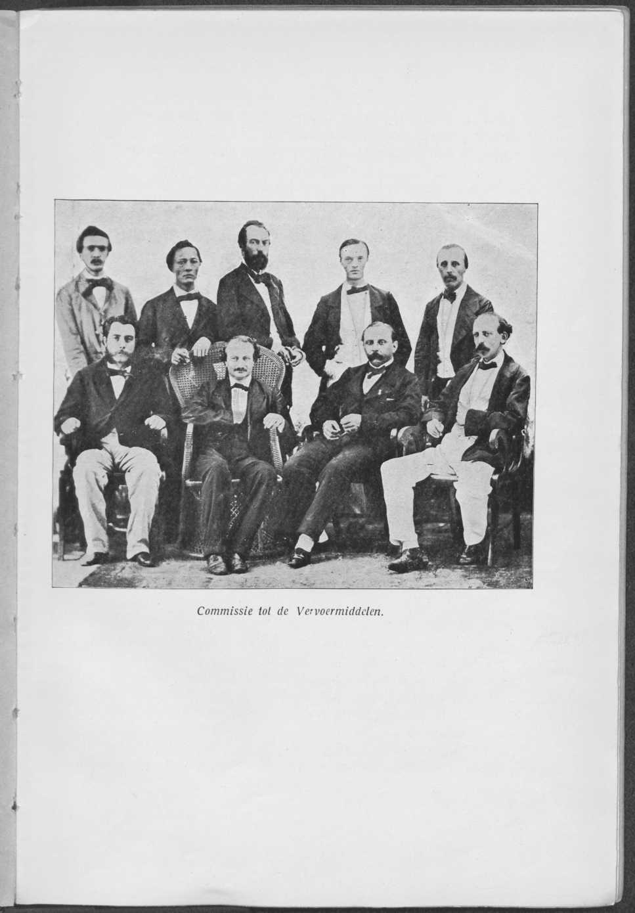
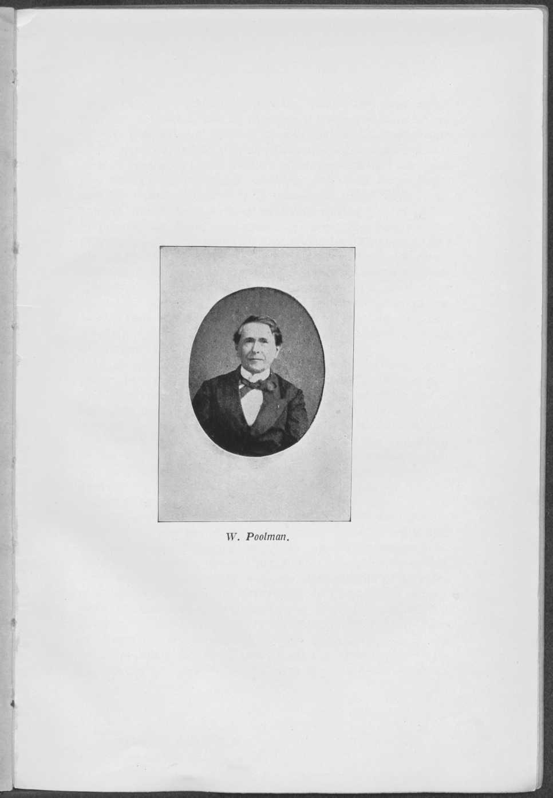
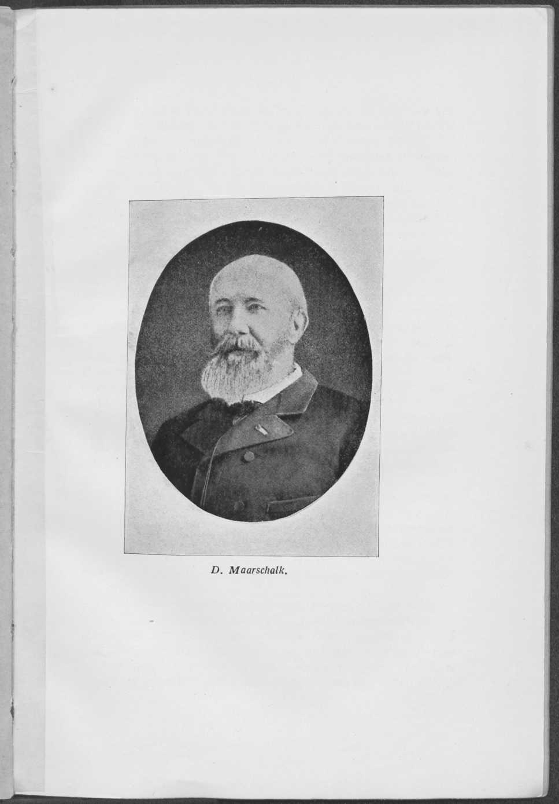

*A. Kereta Api dan Trem di Jawa*

# Bab I. Riwayat Awal (hingga 1863)

Menjelang akhir paruh pertama abad yang lalu, keadaan pengangkutan darat di Jawa menyedihkan. Budidaya tanaman pemerintah (gouvernementscultures) yang terus meluas membuat permintaan akan sarana angkutan yang baik dan dapat diandalkan meningkat sedemikian rupa, sehingga sekitar tahun 1840 orang dapat berbicara tentang keadaan darurat. Kesulitan paling menekan pengangkutan hasil bumi negara, terutama kopi. Maka sering terjadi bahwa di Semarang, ke mana pengangkutan dari Kedoe, Solo, dan Djokja bermuara, kapal-kapal berbulan-bulan menunggu muatan di perairan labuh, sementara di gudang-gudang pedalaman kopi terbaring berjamur. Satu faktor penting lagi ialah bahwa dengan semakin langkanya pedati dan hewan penarik, ongkos sewa naik dalam perbandingan yang sama. Pada tahun 1833 orang membayar lebih dari ƒ 1,36 untuk mengangkut 1 pikol kopi dari Kedoe ke Semarang; pada tahun 1840 jumlah itu telah naik menjadi ƒ 3,30.

Dalam keadaan demikian jelaslah bahwa orang melakukan upaya-upaya putus asa untuk berusaha memperbaiki keadaan. Sesaat terpikir untuk mendirikan sebuah lembaga pengangkutan pemerintah (gouvernementstransportétablissement) di Jawa Tengah; namun perhitungan menunjukkan bahwa diperlukan personel yang banyak untuk mengurus 4000 hewan penarik dan armada pedati yang besar, sehingga penghematan biaya angkutan pasti tidak akan tercapai.

Atas permintaan Pemerintah Hindia, Menteri J. C. Baud mengirim kira-kira empat puluh ekor unta dari Teneriffe ke Jawa. Hewan-hewan itu ternyata tidak dapat menyesuaikan diri di sana dan segera mati. Dengan sebuah kiriman

[hal. 6]

keledai jantan dan betina yang dibeli di Brabant dan Gelderland pun orang tidak lebih beruntung. Ketika itu menjadi jelas bahwa orang harus menempuh jalan lain. Namun pertanyaannya: jalan yang mana?

Menteri Urusan Koloni mengira telah menemukan jalan keluarnya dalam penambahan jumlah ternak, dan karena itu pada Agustus 1841 ia menulis ke Hindia: 

> "Hampir di mana-mana harga ternak telah naik dengan hebat, sehingga bila produksi diperluas lebih lanjut, di beberapa tempat akan timbul hambatan (dalam pengangkutan). Di daerah-daerah Batavia dan Buitenzorg, harga seekor kerbau, yang hanya ƒ 10,— ketika saya pertama kali datang ke Hindia tiga puluh tahun lalu, telah naik menjadi ƒ 50,— tembaga atau ƒ 41,— perak, dan tidak tampak bagi saya bahwa harga yang lebih tinggi itu telah menjadi dorongan bagi perluasan peternakan secara terencana. Kerbau berkembang biak seperti anjing, artinya, pembuntingan kerbau betina (koe) bergantung pada kebetulan apakah hewan itu, pada saat birahinya muncul, bertemu seekor pejantan di padang tempat mereka merumput bersama. Di negeri ini pemilik kerbau betina (koe) akan menghubungi pemilik pejantan. Perundingan semacam itu rupanya tidak dikenal di kalangan orang Jawa. Semuanya mereka serahkan kepada kebetulan, sehingga kerap kali selang waktu antara satu pembuntingan dan pembuntingan berikutnya jauh lebih lama daripada yang perlu dan, demi kepentingan umum maupun kepentingan khusus, dikehendaki. Tidakkah dalam hal ini orang dapat membawa lebih banyak sistem? Tidakkah setiap pemerintah desa dapat diwajibkan memelihara, atas biaya bersama, seekor kerbau jantan, dan memastikan (dengan teguran) bahwa setiap pemilik kerbau betina membawanya kepada pejantan itu begitu birahinya muncul?"

Tidakkah larangan menyembelih kerbau selama lima tahun akan membantu, tanya Menteri Baud selanjutnya kepada Gubernur Jenderal, jika orang Jawa pada masa itu makan daging kambing?

Mengenai perlengkapan, menteri mengirim kira-kira dua puluh as roda gigi (rondselassen) buatan Kagenaar untuk pedati ke Hindia agar dilakukan percobaan dengannya di sana, serta beberapa rel yang di atasnya kendaraan dapat ditarik.

Di Hindia orang sangat skeptis terhadap rencana-rencana Baud. Tentang larangan menyembelih kerbau orang tidak mau tahu, sementara Gubernur Jenderal Mr. P. Merkus menyatakan

*Commissie tot de Vervoermiddelen. (Komisi Sarana Angkutan). Gambar sisipan antara hal. 6 dan 7.*

[hal. 7]

bahwa di padang-padang gembala bersama toh selalu dapat ditemukan seekor pejantan. Orang membatasi diri pada pemberian premi besar untuk pembelian pedati kepada para kontraktor yang dengannya diadakan ikatan jangka panjang.

Wajar bila pada masa ini sesekali timbul pula gagasan untuk memperbaiki keadaan pengangkutan dengan membangun jalan kereta api. Demikianlah Direktur Zeni, kolonel Jhr. C. van der Wijck, pada 15 Agustus 1840 menyampaikan sebuah nota kepada Pemerintah Hindia yang antara lain menyatakan "bahwa pembangunan sebuah jalan kereta api sepanjang pulau akan sangat besar manfaatnya bagi pertahanan". Jalan kereta api itu akan membentang dari Soerabaia melalui Solo dan Djocja ke Batavia dan mendapat beberapa jalur cabang. Karena sebagian medan sama sekali tidak dikenal oleh kolonel itu, seluruh rencana bersifat sangat kasar. Hal yang sama dapat dikatakan tentang rencana Tuan J. Tromp, insinyur kepala Waterstaat dan Bangunan Negara, yang menganjurkan sebuah jalan besi dari Soerabaia sampai Tjilatjap.

Tuan-tuan Mr. J. E. Banck, G. Vrieze, A. de Wilde, dan J. J. van Braam, yang dimintai pertimbangan di Belanda tentang rencana Direktorat Umum Keuangan (Generale Directie der Finantiën) untuk membangun sebuah "tramway" yang di atasnya kuda atau lembu menarik pedati di atas rel, semuanya, sepenuhnya terlepas satu sama lain, menganjurkan pembangunan jalan kereta api sebagai satu-satunya cara untuk membawa perbaikan yang tuntas atas keadaan yang buruk itu.

Selagi perundingan ini berlangsung, firma Dixon en Co., pimpinan pengecoran besi Amsterdam "de Atlas", pada akhir 1841 meminta kepada Menteri Urusan Koloni konsesi untuk membangun sebuah jalan kereta api dari Semarang ke karesidenan Kedoe dan Vorstenlanden, yang berfungsi untuk mengangkut hasil bumi. Jalan itu akan dilalui pedati yang ditarik lembu, kerbau, atau kuda. Pemohon menghitung memerlukan modal saham sebesar ƒ 5.000.000, dengan jumlah itu diminta jaminan bunga 5%. Dengan resolusi menteri tanggal 7 Juni 1843, A. No. 6/304, permohonan ditolak atas dasar jaminan bunga itu.

Bahwa Pemerintah sebenarnya cenderung membantu pihak swasta dalam usaha mereka membangun jalan kereta api di Jawa

[hal. 8]

tampak jelas dari pertukaran pikiran yang mendahului lahirnya Keputusan Raja tanggal 28 Mei 1842 No. 207, yang dimuat dalam Nederlandsche Staatscourant tanggal 6 Juni 1842, yang memuat pengumuman tentang pembangunan "sebuah jalan kereta api besi dari Semarang ke Kedoe dan apa yang disebut Vorstenlanden di Jawa, untuk memajukan pengangkutan barang dan pedati yang ditarik kerbau, dan seterusnya." Dalam laporannya kepada Raja yang menghasilkan keputusan ini, Menteri Baud antara lain tidak menganjurkan pembangunan oleh pemerintah, terutama atas dasar pertimbangan "bahwa di Hindia Pemerintah kadang-kadang berbuat terlalu banyak dan para penduduk terlalu sedikit, dan bahwa setiap kali ada kemungkinan bahwa suatu hal yang memungkinkan dapat menjadi pokok suatu usaha swasta, kecenderungan itu seharusnya didorong dan bukan dilawan."

Sehari setelah pengumuman Keputusan Raja tahun 1842 itu, muncul di Staatscourant sebuah seruan kepada peminat pembangunan jalan kereta api Vorstenlanden. Namun ketika batas waktu yang ditetapkan, yang di dalamnya penawaran harus diterima Menteri, telah lewat dan tak seorang pun mendaftar, Menteri Baud harus memberi tahu Raja bahwa melalui jalan ini pun tidak diperoleh perbaikan. Selain bahwa batas waktu tiga bulan terlalu pendek, ketiadaan jaminan bunga, sarana yang di tempat lain banyak dipakai, yang di Hindia diperkirakan akan menimbulkan "perselisihan dan kesulitan yang tak terbayangkan", ternyata menjadi batu sandungan untuk menyelesaikan pekerjaan dengan tuntas. Namun pada masa itu ketentuan ini tidak dapat ditiadakan, karena peta Jawa yang dapat diandalkan tidak ada, sehingga perkiraan biaya hanyalah tebakan asal-asalan, dan tidak ada data untuk menaksir pengangkutan di masa depan, jadi untuk menaksir kemungkinan pendapatan.

Untuk mengatasi kekurangan data, Pemerintah Hindia, atas permintaan Menteri Baud, telah meminta letnan satu ajudan zeni G. H. Uhlenbeck, yang kemudian menjadi direktur B.O.W. (Burgerlijke Openbare Werken) dan Menteri Urusan Koloni, melakukan

[hal. 9]

pengukuran untuk jalan kereta api dari Semarang ke Kedoe dan Vorstenlanden. Pengukuran ini selesai pada Mei 1844; kesimpulan laporannya ialah bahwa pembangunan tidak dianjurkan sebagai "usaha yang berisiko, berbahaya, dan tidak mencapai sasaran". Demikian pula pendapat para atasan Letnan Uhlenbeck.

Firma Dixon sementara itu tidak tinggal diam, melainkan menyusun perhitungan baru, yang hasilnya ialah bahwa pada April 1845 diajukan permohonan konsesi baru, kali ini tanpa tuntutan jaminan bunga. Permohonan ini pun ditolak, yakni karena Tuan-tuan W. Dennison, E. L. Jacobson, dan L. J. Enthoven telah mengajukan permohonan konsesi yang lebih luas, dengan syarat boleh memperoleh kayu cuma-cuma dari hutan-hutan pemerintah dan dapat memakai 5000 kuli per hari. Namun karena pembangunan benteng-benteng pertahanan didahulukan, terdapat keberatan yang dominan terhadap permintaan terakhir itu; sehingga ketika Menteri Urusan Koloni mengajukan lebih banyak lagi kesulitan, Tuan Dennison mengundurkan diri pada Desember 1845.

Pada kurun ini masih diterima beberapa permohonan konsesi lagi, yakni dari Tuan Th. Wilson, dari Tuan-tuan G. A. Lievendag dan M. G. Tetar van Elven, dan akhirnya juga dari Tuan L. (van Woudrichem) van Vliet yang telah dieksternir, yang tidak satu pun menghasilkan hasil positif, melainkan hanya berakibat bahwa Pemerintah Hindia mengadakan penyelidikan lebih lanjut. Penyelidikan ini menghasilkan akibat yang sama sekali tak terduga. Gubernur Jenderal J. J. Rochussen rupanya telah sampai pada pendapat 1e. bahwa pembangunan jalan kereta api di Jawa itu berguna, perlu, dan mungkin, 2e. bahwa jalan kereta api harus dibangun dan dikelola oleh Pemerintah, dan 3e. bahwa dana yang diperlukan untuk sementara dan kemungkinan secara berkelanjutan akan tersedia, tanpa membahayakan "surplus (batig slot)" keuangan Hindia yang berharga itu. Mengenai butir 2, Tuan Rochussen menulis kepada Menteri "bahwa ia lebih suka tidak melihat jalan kereta api di Jawa, daripada jika jalan itu tidak dibangun dan dieksploitasi oleh Pemerintah." Hal ini dibenarkan dengan pernyataan yang kini terdengar sangat aneh, bahwa jalan kereta api swasta sama sekali tidak sesuai dengan seluruh tata kehidupan pribumi dan dengan hubungan pemerintahan Eropa dengan pribumi, sedangkan hasil bumi pemerintah toh harus diangkut oleh pemerintah sendiri, bila pengangkutan hendak tetap murah; sebab pihak swasta hanya akan menuntut bunga dan dividen tinggi, sehingga menuntut ongkos angkut tinggi.

Menteri Urusan Koloni Baud hanya sebagian sependapat dengan Gubernur Jenderal. Terutama terhadap bagian keuangan

[hal. 10]

timbul keberatan serius. Raja sebaliknya ternyata pendukung gagasan-gagasan Rochussen, dengan pengertian bahwa ia menghendaki manfaat setiap ruas jalan kereta api dibuktikan tersendiri. Ketika hal itu disampaikan kepada Gubernur Jenderal, ia segera membatalkan pesanan bantalan kayu besi (ijzerhout) yang telah dipesan, dan ia membiarkan beberapa ruas lintas tertentu diukur lebih lanjut oleh sebuah komisi di bawah pimpinan letnan zeni D. Maarschalk, antara lain hubungan Buitenzorg-Batavia.

Setelah beberapa pertukaran pikiran tertulis antara Pemerintah Hindia dan Pemerintah Pusat di Belanda, Menteri Urusan Koloni yang baru menjabat, C. F. Pahud, melontarkan gagasan untuk meninggalkan asas pembangunan oleh negara. Rencana ini mendapat sambutan dari Gubernur Jenderal Mr. A. J. Duymaer van Twist, yang tidak dapat membagi keberatan pendahulunya terhadap pembangunan oleh negara. Yang Mulia berpendapat bahwa akan dapat diperoleh cukup tenaga kerja untuk melaksanakan pekerjaan itu dengan kerja bebas. Mengenai soal uang ia menulis: 

> "Saya tidak ragu menyatakan bahwa, seandainya saya memiliki jutaan yang diperlukan untuk sebuah jalan kereta api dari Soerabaia ke Anjer, saya, bila pilihan ada pada saya, tidak akan memakainya untuk itu, melainkan berpendapat bahwa uang itu dapat dimanfaatkan dengan lebih berguna daripada untuk membangun jalan kereta api."

Perundingan antara Gubernur Jenderal dan Menteri melahirkan Keputusan Raja yang terkenal tanggal 31 Oktober 1852 H 22 (Ind. Stbl. 1853 No. 4), yang membuka jalan bagi orang Belanda untuk memperoleh konsesi dari Gubernur Jenderal, dengan syarat-syarat tertentu, untuk membangun jalan kereta api di Hindia Belanda.

Namun keputusan ini tidak banyak membuahkan hasil. Keputusan itu merujuk para pemohon kepada Gubernur Jenderal, tidak menyebut sepatah kata pun tentang dukungan yang dapat diberikan Pemerintah, sedangkan ditetapkan syarat bahwa konsesi tidak akan diberikan sebelum dari suatu penyelidikan khusus ternyata bahwa pembangunan jalan di tempat yang ditunjukkan itu berguna dan dapat dilaksanakan. Dengan tiadanya peta yang dapat diandalkan dan data ekonomi, syarat terakhir ini mengakibatkan bahwa para pemohon konsesi harus lebih dahulu mengeluarkan modal besar

*W. Poolman. Gambar sisipan antara hal. 10 dan 11.*

[hal. 11]

untuk pengukuran yang layak, tanpa kepastian sedikit pun bahwa atas permohonan itu konsesi akan diberikan. Dalam praktiknya, setiap permohonan ditolak atau, seperti akan dikatakan Mr. N. P. van den Berg, "ad calendas graecas verschoven werd" (ditunda hingga kalender Yunani). Maka keputusan itu pun tidak membawa hasil yang berguna, sebelum Gubernur Jenderal Baron Sloet van de Beele kemudian, yakni pada 1862, memberinya "tafsiran menurut keadaan (gelegenheidsuitleg)". Semua permohonan konsesi yang diproses pada tahun-tahun pertama setelah pengumuman keputusan itu, antara lain yang untuk sebuah "leuningspoor" dari Tuan-tuan Deeleman dan Rappard, demikian pula yang dari O.I. Maatschappij van Administratie en Lijfrente, yang melalui Tuan Maarschalk telah menyuruh membuat proyek jalan kereta api kuda untuk pengangkutan barang antara Batavia dan Buitenzorg, yang dari Tuan Struben, yang dari Tuan-tuan Thomson, Rauws, dan Lebret, dan juga yang dari firma Maclaine Watson, kandas, langsung maupun tidak langsung, pada ketentuan-ketentuan keputusan itu.

Permohonan terpenting dari kurun ini tentu saja yang dari Tuan-tuan Jhr. J. C. Reynst, W. Poolman, dan A. Fraser, yang meminta izin untuk membangun jalan kereta api dari pedalaman ke Batavia, Semarang, Tjilatjap, dan Soerabaia. Konsesi itu harus berlangsung 99 tahun, orang menganggap diperlukan modal 125 juta gulden, sedangkan selama 33 tahun diminta jaminan 5% atas modal itu. Keinginan lain para pemohon ialah janji bahwa selama 10 tahun mereka boleh mengangkut hasil bumi, barang, dan uang pemerintah dengan harga rata-rata sepuluh tahun sebelumnya.

Di antara para penasihat di Hindia terdapat perselisihan sebesar-besarnya mengenai hampir semua butir yang dapat dibicarakan dalam pembangunan jalan kereta api. Mantan Menteri Pahud, yang kemudian menjabat Gubernur Jenderal, pada September 1858 menulis kepada Menteri Urusan Koloni bahwa menurut pendapat pribadinya pembangunan jalan kereta api di Jawa, ditinjau baik dari sudut keuangan maupun dari sudut politik dan strategi, menjanjikan buah yang paling indah dan akan menjadi pengungkit yang kuat untuk menjamin kekuasaan Belanda dan untuk mengembangkan kemakmuran Jawa; bahwa usaha itu mungkin dan tidak boleh diwujudkan oleh Negara, melainkan harus oleh pihak swasta,

[hal. 12]

tetapi bahwa dalam hal itu bantuan negara, bila perlu bantuan negara yang besar, tidak dapat ditiadakan. Mengenai sifat bantuan itu, yang mengenainya para penasihat pun tidak dapat mencapai kata sepakat, Gubernur Jenderal berpendapat bahwa penjaminan bunga minimum akan menjadi sarana bantuan yang paling layak dianjurkan. Kepada Tuan-tuan Reynst c.s. Gubernur Jenderal pada saat yang sama memberi tahu bahwa ia telah berunding dengan Menteri dan bahwa keputusan akhir masih akan menyusul.

Sebagai Menteri Urusan Koloni sementara itu telah menjabat mantan Gubernur Jenderal J. J. Rochussen, yang masih banyak berpihak pada jalan kerbau dan pembangunan oleh negara, dan yang setelah cukup lama menunda, menyerahkan nasihat-nasihat tersebut di atas kepada dua insinyur Belanda, Tuan-tuan L. J. A. van der Kun, inspektur kepala, dan D. J. Storm Buysing, insinyur kepala Waterstaat, yang pada Januari 1860 menyampaikan laporan mereka. Tuan-tuan itu sampai pada kesimpulan-kesimpulan berikut: 

> "bahwa usaha jalan kereta api di Jawa bagi perusahaan swasta tidak mungkin, tanpa kerja sama yang sangat kuat dari Negara, karena maksudnya ialah pengangkutan murah sehingga tarif tinggi tidak dapat diizinkan tanpa menyimpang dari tujuan, sedangkan keuntungan dari pengangkutan penumpang diperkirakan sangat kecil, mengingat sedikitnya penduduk (Eropa) di pulau itu; bahwa jaminan bunga yang diminta akan membebani Negara secara berat tanpa keuntungan sepadan;
>
> "bahwa jaminan bunga bagi Negara membawa semua kerugian jalan kereta api negara dan menghilangkan keuntungan-keuntungan yang dengan demikian dilepaskan tanpa guna;
>
> "bahwa pembangunan dan eksploitasi di Jawa seharusnya berlangsung atas tanggungan negara;
>
> "bahwa bila hal itu tidak dikehendaki, maka disarankan agar pembangunan jalan dan pengadaan materiel dilakukan dengan biaya negara, agar dengan demikian orang berkesempatan menyewakan eksploitasi jalan itu untuk waktu singkat;
>
> "bahwa dengan demikian konsesi yang diminta Tuan-tuan Reynst c.s. seharusnya ditolak;
>
> "bahwa bila bagaimanapun orang hendak berunding dengan mereka, perubahan dan penambahan yang penting atas syarat-syarat yang diusulkan tidak dapat dihindari;

[hal. 13]

> "bahwa dalam segala hal disarankan untuk segera memulai dengan biaya negara pengukuran medan dan penyusunan rencana-rencana jalan kereta api serta anggaran-anggarannya, pertama untuk lintas-lintas yang pembangunannya segera paling dikehendaki di Jawa, dan sesudah itu oleh tangan yang sama juga menyiapkan rancangan untuk lintas-lintas lainnya, agar diperoleh sistem jalan kereta api di Jawa yang tertata baik dan saling bersambungan;
>
> "bahwa bila rencana-rencana dan anggaran-anggaran telah disetujui, lintas-lintas dikerjakan berturut-turut dengan kecepatan yang lebih atau kurang, menurut dana yang akan tersedia."

Ketika kepala insinyur Burgerlijke Openbare Werken yang sedang cuti, H. de Bruyn, juga menasihatkan dalam arti serupa, meskipun ia tidak merasakan mendesaknya penetapan suatu rencana umum jalan kereta api sebegitu kuat, Menteri Rochussen pada Juni 1860 mengusulkan kepada Raja agar pembangunan jalan kereta api di Jawa tidak diwujudkan selain oleh negara, "setidaknya selama tidak terbukti bahwa hal itu dapat diperoleh dengan cara lain, kecuali dengan pengorbanan keuangan dan lain-lain yang seberat yang sampai sekarang dituntut oleh para pemohon swasta."

Menyetujui gagasan Tuan-tuan van der Kun dan Storm Buysing untuk mengirim para ahli dari Belanda ke Hindia guna penyelidikan setempat, yang baru sesudahnya akan diputuskan apakah asas pembangunan oleh swasta yang tercantum dalam Keputusan Raja 31 Oktober 1852 Lett. H. No. 22 yang dibahas sebelumnya perlu ditinggalkan, Menteri meminta kepada Raja agar Tuan-tuan T. J. Stieltjes dan John Dixon diutus sebagai ahli, sedangkan selanjutnya diusulkan agar Gubernur Jenderal diberi instruksi: 1e. bahwa sambil menunggu apa yang kemudian akan diputuskan setelah misi Stieltjes selesai, Pemerintah tidak hendak memberikan jaminan bunga seperti yang diminta Tuan-tuan Reynst c.s., 2e. bahwa, karena kebutuhan paling mendesak ialah perbaikan pengangkutan antara Semarang dan pedalaman, suatu usulan tersendiri mengenai hal itu dinanti secepat mungkin.

[hal. 14]

Ketika Raja menyetujui hal ini, sudah 2 hari setelah penyampaian laporan menteri itu, yakni pada 11 Juni 1860, bekas kapten artileri T. J. Stieltjes diangkat menjadi Penasihat Urusan Teknis pada Departemen Urusan Koloni. Dengan keputusan tersendiri Tuan Stieltjes ditugaskan pergi ke Jawa untuk menyelidiki sarana angkutan yang ada dan mengajukan usulan mengenai apa yang diperlukan untuk memperbaikinya. Kepadanya ditambahkan Tuan John Dixon, yang diangkat sebagai "insinyur kepala untuk jalan kereta api dan industri di Hindia Belanda".

Dengan surat tanggal 16 Juni 1860 Pemerintah Hindia diberi tahu tentang tindakan-tindakan ini, sedangkan Gubernur Jenderal diperintahkan memberi tahu Tuan-tuan Reynst c.s. bahwa sambil menanti hasil komisi Stieltjes (yang disebut Komisi Sarana Angkutan, Commissie tot de Vervoermiddelen), usul-usul mereka tidak dapat dibahas. Menteri menyatakan pula bahwa menurut pendapatnya belum ada kebutuhan akan jaringan jalan kereta api seluas yang dikehendaki kombinasi Reynst.

Dengan Keputusan Pemerintah tanggal 21 Agustus 1860 No. 52, para pemohon konsesi diberi tahu, setelah itu kombinasi itu tak lama kemudian bubar.

Setelah Tuan-tuan Stieltjes, Dixon, dan Jhr. C. van Panhuys tiba di Jawa, mereka segera diberi tahu beberapa desiderata Pemerintah Hindia dan para penasihatnya, yakni bahwa pencarian sarana untuk pengangkutan penumpang yang dipercepat merupakan pokok utama, bahwa harus diperhitungkan tuntutan pemusatan dan pemindahan pasukan, bahwa dalam pembangunan tidak boleh dipakai kerja wajib (herendiensten), melainkan kerja bebas harus menjadi aturan dengan kemungkinan mendatangkan kuli Tionghoa, dan bahwa akhirnya pemakaian ternak sebagai tenaga penarik harus ditolak. Tuan Stieltjes membayangkan akan membuat sebuah avant-projet (rancangan awal) jaringan jalan kereta api di seluruh Jawa, berkaitan dengan jalan air yang ada dan yang akan digali; namun Pemerintah Hindia menyatakan bahwa pertama-tama ia menghendaki rencana yang tepat untuk sebuah lintas dari Semarang ke

*D. Maarschalk. Gambar sisipan antara hal. 14 dan 15.*

[hal. 15]

Vorstenlanden, dan baru di tempat kedua hubungan Batavia dengan Preanger harus mendapat giliran.

Dengan semangat besar Komisi Sarana Angkutan mulai bekerja; di dalamnya, untuk menyebut yang paling dikenal saja, bekerja profesor kemudian, insinyur N. H. Henket dan insinyur S. E. W. Roorda van Eijsinga yang kemudian dieksternir, serta mayor infanteri R. F. de Seyff, sehingga laporan tertanggal 6 November – 22 Desember 1862 (demikian tertulis di sumber, dua tanggal dipisahkan tanda pisah) terbit. Tuan Stieltjes menyebut sebagai kekurangan sarana angkutan yang ada: mahalnya, kurangnya kecepatan, dan kurangnya kepastian. Sang pelapor berpendapat bahwa jalan kereta api dari Semarang ke Bawen langsung akan menghasilkan bunga, sehingga ruas ini dapat diberikan sebagai konsesi tanpa jaminan bunga, tetapi dengan beberapa kemudahan. Dalam beberapa tahun setelah dibukanya eksploitasi, menurut pendapatnya hubungan-hubungan berikut akan menguntungkan:

1e. perpanjangan lintas tersebut di atas melalui Salatiga, Kaligandoe, dan Bojolali sampai suatu titik pada Kanal Progo-Solo yang akan dibangun;

2e. sebuah jalan kuda (paardebaan) dari Merakmati ke Medono dan membelok ke Temanggoeng dan Magelang;

3e. sebuah jalan lokomotif dengan dua kereta api ke tiap arah dari Batavia ke Buitenzorg dengan percabangan, dan pada mulanya satu kereta api sehari ke tiap arah dari tengah jalan antara Batavia dan Buitenzorg melalui Tjibaroessa di lembah Tjibehet, melintasi dataran Tjiandjoer sampai permulaan dataran Bandoeng;

4e. sebuah jalan kuda dari Pasoeroean ke Malang, yang cocok untuk kelak juga dilalui lokomotif.

Dari sudut militer, yang pertama-tama dipertimbangkan ialah perpanjangan lintas dari Batavia ke dataran Bandoeng sampai Tjitjalengka dan jika mungkin sampai Tjilatjap, sebuah lintas dari Ngawi ke Kertosono, dan perpanjangan lintas yang disebut di atas pada butir 4 ke Soerabaia.

Selanjutnya dirancang seluruh sistem kanal yang berhubungan erat dengan jalan kereta api. Di tempat yang hanya dapat diperhitungkan pengangkutan tahunan paling banyak 150.000 – 200.000 pikol (tanda pisah dalam sumber), jalan kereta api kecil dengan "lebar jalan 6 sampai 9 palem, batang rel 6 sampai 9 pon Belanda per meter, dan balok batu (steenen neuten) sebagai alas" dapat dipakai, sedangkan kerbau, lembu, atau kuda

[hal. 16]

dapat dipakai sebagai tenaga penarik. Sebaliknya, jalan-jalan kereta api besar yang disebut di atas harus segera dibangun secara lengkap dan menurut satu sistem yang sama agar kelak dapat dihubungkan satu sama lain, sehingga dapat tercipta lintas menerus dari Anjer sampai Tjilatjap, kemudian sampai Soerabaia dan lebih jauh. Untuk kota-kota besar dianggap diinginkan omnibus kuda, sedangkan mengenai perbaikan jalan biasa dan sarana angkutan yang ada, diberikan petunjuk-petunjuk yang diperlukan.

Sebelum laporan ini diajukan, Tuan Stieltjes mendapati sebuah permohonan konsesi diserahkan ke tangannya untuk dimintai nasihat. Permohonan itu berasal dari Tuan-tuan W. Poolman, S. Fraser, dan E. H. Kol, yang kemudian disusul Tuan F. Ament. Permohonan itu diajukan pada 28 Agustus 1861 kepada Menteri Urusan Koloni dan mencakup pembangunan dan eksploitasi sebuah jalan kereta api dari Semarang melalui Soerakarta ke Djokja, dengan syarat bahwa insinyur dan pekerja asing boleh didatangkan, dan bahwa Negara selama 38 tahun akan menjamin bunga 5% atas modal pembangunan yang ditaksir 18 juta gulden. Menteri Mr. J. Loudon, salah seorang pengganti Tuan Rochussen, menyerahkan berkas ini kepada Pemerintah Hindia dengan permintaan agar segera diproses.

Pada 8 Januari 1862 Tuan Stieltjes menyampaikan nasihatnya. Isinya tidak terlalu menguntungkan para pemohon; permohonan konsesi dianggap tidak dapat dikabulkan, yakni karena trase yang dipilih menghindari daerah paling produktif di Jawa Tengah dan akan melewati medan yang sedikit berproduksi, sehingga pertanyaannya ialah apakah jalan kereta api itu akan menguntungkan dan besar kemungkinan Negara selama bertahun-tahun akan ditagih jaminan bunga.

Berbagai pejabat masih didengar mengenai permohonan konsesi Poolman c.s. Semuanya ternyata pendukung pembangunan oleh swasta; namun pendapat mereka berbeda sejauh menyangkut arah jalan kereta api dan syarat-syarat pemberian konsesi. Perbedaan pendapat yang mendalam ini diakhiri oleh Gubernur Jenderal yang baru menjabat, Mr. L. A. J. W. Baron Sloet van de Beele, dengan melakukan sendiri perjalanan ke Jawa Tengah dan kemudian dengan keputusan tanggal

[hal. 17]

28 Agustus 1862 No. 1, di bawah persetujuan lebih lanjut Raja dan pengesahan dengan undang-undang bila itu diperlukan, serta dengan pengecualian bagi Menteri Urusan Koloni untuk berunding lebih lanjut dengan para pemohon, memberikan konsesi menurut sebuah trase yang disusun menurut pandangan kapten W. Beyerinck dan yang agak menyimpang dari yang diminta.

Menteri G. H. Uhlenbeck, orang yang sama yang sebagai letnan zeni dahulu pernah memeriksa hubungan Batavia-Buitenzorg, ternyata bukan pendukung konsesi parsial, sehingga berkas-berkas mengenai permohonan konsesi itu melalui Menteri Dalam Negeri sampai ke sebuah komisi yang terdiri atas Tuan-tuan J. P. de Bordes dan Jhr. Lewe, yang menyampaikan laporan pada pertengahan November 1862.

Pada 1861 dan awal 1862 Tuan L. (van Woudrichem) van Vliet yang telah dieksternir, yang disebut sebelumnya, telah memohon konsesi untuk jaringan jalan kereta api yang saling bersambungan di Jawa. Hasilnya negatif, karena permintaan itu ditolak. Namun gagasan-gagasan Tuan van Vliet diambil alih oleh sebuah kombinasi yang berpengaruh, terdiri atas Tuan-tuan Mr. J. E. Banck, D. Bauduin, J. P. Dudok van Heel, W. F. Heshuysen, W. H. von Oven, Dr. P. J. Veth, Paul C. van Vlissingen, bergabung dengan Tuan van Vliet. Pada 18 November 1862, dengan mengetahui gagasan-gagasan Menteri, mereka memohon konsesi untuk empat lintas dari pedalaman ke pantai, yang disebut "steeklijnen" (lintas cabang), yang kemudian secara bertahap akan dihubungkan satu sama lain. Orang kini kembali terjebak dalam jalan buntu, yakni apakah konsesi parsial ataukah konsesi untuk jaringan yang bersambung yang layak dianjurkan, ketika Menteri Uhlenbeck, pendukung gagasan yang terakhir, mengundurkan diri dan digantikan oleh Tuan J. D. Fransen van de Putte, yang setelah menurunkan sedikit tarif maksimum, serta mengurangi jaminan bunga dari 5 menjadi 4½%, mengupayakan agar dengan Keputusan Raja tanggal 10 Maret 1863 No. 1 konsesi yang telah diubah itu disetujui, dengan tetap diperlukan pengesahan beberapa pasal melalui undang-undang. Rancangan undang-undang untuk itu diajukan pada 12 Maret 1863; pada 10 Juni terbit Laporan Komisi Pelapor (Commissie van Rapporteurs). Sudah 6 hari kemudian Memorie van Beantwoording (Nota Jawaban) terbit; dari berkas-berkas ternyata bahwa lintas itu akan mendapat trase yang agak lain, yakni seperti yang dipilih oleh overste (letnan kolonel) E. A. Haitink,

[hal. 18]

sedangkan jalur cabang ke Willem I akan dibangun.

Setelah rancangan undang-undang itu, sesudah pembahasan berhari-hari dalam sidang Tweede Kamer (Majelis Rendah) tanggal 25 Juni 1863, diterima dengan 54 suara lawan 13, dan di Eerste Kamer (Majelis Tinggi) Staten-Generaal tidak menemui perlawanan, terbitlah undang-undang tanggal 6 Juli 1863 dalam Staatsblad 1863 No. 110 (Ind. Stbl. No. 116).

Permintaan lebih lanjut kombinasi Banck untuk membangun lintas-lintas lain tidak berhasil. Namun permintaan itu memang menimbulkan polemik yang ramai di surat kabar dan majalah; banyak brosur lahir karenanya. Pemberian konsesi tidak terjadi, kendati para pemohon memperoleh sangat banyak dukungan di luar kalangan pemerintahan, dan antara lain komisi ad hoc dari Indisch Genootschap, yang terdiri atas Tuan-tuan J. Millard, P. J. Bachiene, dan J. J. van Kerkwijk, tidak bersikap tidak bersimpati terhadap usulan para pemohon.

Perang pena yang tidak kalah sengit dibandingkan permohonan konsesi Poolman c.s. dan Banck c.s. dikobarkan oleh laporan Stieltjes yang dibahas di atas. Sebuah surat dari Tuan Stieltjes kepada Tweede Kamer agar mengenai pemohon Poolman tidak diambil keputusan sebelum rencana, bestek, dan anggaran dipelajari dengan saksama, mendatangkan ketidaksenangan Menteri Urusan Koloni Fransen van de Putte kepadanya. Hubungan Stieltjes dengan Gubernur Jenderal Sloet van de Beele pun sangat tidak baik; perbedaan pendapat yang mendalam itu sudah bermula dari karier mereka berdua di Belanda. Akibat kepekaan menteri tampak dalam pemberhentian mendadak yang diberikan tanpa diminta kepada Tuan Stieltjes sebagai penasihat teknis dengan Keputusan Raja tanggal 20 Juni 1863 No. 20; ia kemudian kembali ke Belanda dan menerbitkan serangkaian pamflet. Pekerjaan Komisi lalu dilanjutkan di bawah pimpinan overste de Seyff.

Semua pertengkaran ini, yang diperjuangkan dengan sengit, membuat perkara jalan kereta api Jawa tidak menjadi lebih populer. Terlebih lagi karena di dalam Komisi Sarana Angkutan pun banyak perselisihan terjadi, antara lain antara Stieltjes dan Dixon, yang terakhir akhirnya harus mundur dari medan. Namun bukan hanya perbedaan pendapat yang berkobar keluar dengan sengit ini yang merugikan

[hal. 19]

kelayakan kredit perusahaan muda itu. Ada satu kelompok besar di Hindia yang sama sekali tidak menghendaki jalan kereta api, yang mengharapkan berbagai kesulitan teknis, dan yang selain itu karena pertimbangan politik menentang perbaikan sarana komunikasi. Juru bicara para penentang ialah mantan residen J. D. van Herwerden, yang pada 1863 menerbitkan brosur yang sangat menghebohkan berjudul: *De Spoorwegkwestie op Java*. Bahkan di Tweede Kamer Staten-Generaal suasana pesimis itu menemukan gaungnya.

Kendati semua faktor tak menguntungkan itu, para pemegang konsesi dengan riang mulai bekerja. Segera terbentuk sebuah perseroan terbatas, Nederlandsch-Indische Spoorweg Maatschappij (keputusan 17 September 1863 No. 37), kepada siapa konsesi dialihkan. Sebelum beralih ke uraian tentang riwayat Maatschappij itu, di sini perlu disebutkan ketentuan-ketentuan pokok konsesi yang diberikan:

1e. Konsesi diberikan untuk jangka waktu 99 tahun, yang mulai berlaku pada hari jalan kereta api seluruhnya dibuka untuk umum;

2e. setelah jangka waktu itu berakhir, jalan beserta seluruh perlengkapannya jatuh kepada Negara dengan bebas dan tanpa beban;

3e. setelah berakhirnya 20 tahun pertama dan selanjutnya setiap 10 tahun, Negara berhak mengambil alih perusahaan dengan harga yang ditetapkan menurut ukuran perhitungan yang telah ditentukan;

4e. selama 33 tahun pertama eksploitasi Negara menjamin bunga 4½% atas modal yang diperlukan untuk pembangunan dan penyelesaian, dengan syarat tidak lebih dari jumlah ƒ 630.000,— setahun;

5e. hingga akhir Desember 1868 Negara menanggung pembayaran bunga 4½% atas modal yang disetor;

6e. begitu jumlah yang terutang oleh perseroan kepada Negara berkenaan dengan pembayaran bunga ini dan dengan uang muka yang mungkin diberikannya akibat jaminan bunga itu telah dilunasi seluruhnya, Negara akan ikut serta untuk seperempat bagian dalam keuntungan yang diperoleh setiap tahun di atas angka 5%;

[hal. 20]

7e. lebar sepur dan berat rel akan ditetapkan oleh Gubernur Jenderal dalam perundingan dengan para pemegang konsesi;

8e. kepada para pemegang konsesi diizinkan mendatangkan pekerja dari tempat lain, sedangkan setelah selesainya jalan kereta api Gubernur Jenderal berhak memerintahkan pemulangan mereka;

9e. kepada para pemegang konsesi diberikan hak didahulukan untuk membangun dan mengeksploitasi perpanjangan dan jalur cabang jalan kereta api yang dikonsesikan.
