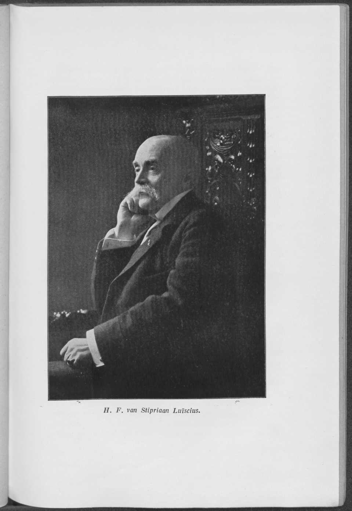

# Bab VI. Kurun 1893 hingga 1906

Tidak ada gunanya menelusuri bagaimana setiap rancangan undang-undang perluasan jaringan negara di Jawa setelah 1893, ketika sebuah rencana lintas yang tetap telah diterima, terwujud; cukuplah dengan daftar singkat. Demikianlah, dengan undang-undang tanggal 20 Juli 1895 (Ind. Stbl. No 212) ditetapkan pembangunan lintas pemendek (afkortingslijn) Tarik-Soerabaia sepanjang 30 K.M., setelah suatu upaya terdahulu untuk membangun lintas ini kandas, terutama akibat perlawanan Oost-Java Stoomtram Maatschappij, yang merasa kepentingannya dirugikan (dalam sidang Tweede Kamer tanggal 29 November 1892 rancangan undang-undang yang bersangkutan ditolak dengan 50 suara lawan 27). Dari lintas ini, ruas Tarik-Sepandjang (23 K.M.) mulai dieksploitasi pada 1 Juli 1897, sedangkan ruas Sepandjang-Wonokromo sepanjang 7 K.M. rampung pada 1 Desember 1898.

Di sini perlu disebutkan bahwa dengan undang-undang tanggal 31 Desember 1904 (Ind. Stbl. 1905 No 11) ditetapkan pembangunan lintas trem negara yang pertama, yaitu lintas Madioen-Ponorogo dengan dua lintas samping dari Ponorogo ke Balong dan dari Ponorogo ke Soemoroto. Lintas trem sepur normal sepanjang 56 K.M. ini mulai dieksploitasi dalam tempo yang berbeda-beda antara 15 Mei 1907 dan 1 Desember 1907.

Mengenai Lintas Timur (Oosterlijnen) milik Negara, undang-undang tanggal 31 Desember 1898 (Ind. Stbl. 1899 No. 13) berkenaan dengan pembangunan ruas Kalisat-Banjoewangi sepanjang 86 K.M. Pada 10 September 1902 ruas sepanjang 30 K.M. sampai terowongan Mrawan mulai dieksploitasi. Pada 2 Februari 1903 menyusul ruas sampai Banjoewangi. Akhirnya undang-undang tanggal 22 Juli 1899 (Ind. Stbl. No. 272) masih menetapkan pembangunan sebuah rel pelabuhan di tepi timur Kalimas, panjangnya kira-kira 4 K.M.; pada 1 Juli 1901 ruas ini rampung.

Lintas Barat (Westerlijnen) mula-mula diperluas melalui pembangunan Lintas Banten (Bantamlijn) yang ditetapkan dengan undang-undang. Pada 15 Juli 1896 undang-undang ini terbit dalam Ind. Stbl. No 180, setelah itu pada 2 Januari 1899 ruas Batavia-Doeri-Tangerang sepanjang

[hal. 59]

23 K.M., dan pada 1 Oktober 1899 hubungan Doeri-Rangkasbetoeng (76 K.M.), terwujud. Pada 1 Juli 1900 ruas Rangkasbetoeng-Serang (34 K.M.) mulai dieksploitasi, dan pada 20 September ruas Serang-Anjerkidoel sepanjang 42 K.M. Tujuan jalan kereta api itu ialah membebaskan daerah Banten dari keterasingannya dan membuatnya lebih mudah dijangkau bila terjadi gangguan ketertiban, yang kebutuhannya terbukti pada kerusuhan Tjilegon. Kemudian, berkaitan dengan keadaan yang berubah akibat pengambilalihan Bataviasche Ooster Spoorweg, pembangunan lintas samping Tanah Abang-Weltevreden yang ditetapkan dengan undang-undang 15 Juli 1896 tidak dilaksanakan, melainkan digantikan dengan pembangunan ruas-ruas Tanah Abang-Struyswijk-Krawanglijn dan hubungan Kemajoran-Antjol. Pada 1 Maret 1904 ruas-ruas penghubung ini, masing-masing sepanjang 6 dan 4 K.M., mulai digunakan.

Perluasan kedua dialami Lintas Barat ketika Negara, dengan pembelian, menjadi pemilik lintas-lintas Bataviasche Ooster Spoorweg Maatschappij. Perseroan ini sia-sia berusaha memperoleh konsesi untuk memperpanjang lintasnya ke Cheribon; ia terpaksa puas dengan perpanjangan lintasnya dari Kedoenggedeh ke Krawang, yang untuknya konsesi diberikan dengan keputusan 10 Desember 1895 No 19. Pada ruas sepanjang 6 K.M. ini terdapat sebuah jembatan besar di atas Tjitaroem. Pada 20 Maret 1898 ruas itu mulai dieksploitasi.

Untuk perpanjangan lintas B.O.S. ini ke Lintas Preanger, kebetulan telah diterima beberapa permohonan konsesi ketika Menteri Cremer mencapai kesepakatan dengan Bataviasche Ooster Spoorweg Maatschappij mengenai pembelian lintas sepanjang 63 K.M. itu, dan untuk itu mengajukan rancangan undang-undang kepada Staten-Generaal. Undang-undang ini terbit pada 9 Juni 1898 dalam Indisch Staatsblad No 222. Dengan harga ƒ 3.900.000 Negara menjadi pemilik lintas itu, yang dimaksudkan untuk diteruskan sampai Padalarang.

Rancangan undang-undang untuk itu diterima pada 29 Desember 1900 bersamaan dengan Anggaran Hindia untuk 1901 dan terbit dalam Indisch Staatsblad 1901 No 8. Pada 27 Desember 1902 ruas pertama Krawang sampai Poerwakarta rampung; ruas kedua, sebuah lintas pegunungan berat sepanjang 56 K.M. yang di dalamnya terdapat terowongan panjang Sasaksaat, dibuka untuk lalu lintas umum pada 2 Mei 1906.

[hal. 60]

Hampir bersamaan, yakni pada 18 Juni 1906, lintas samping Lintas Banten, yaitu dari Rangkasbetoeng ke Laboean, sepanjang 56 K.M., ditambahkan pada Jaringan Barat. Pembangunan lintas ini telah disetujui dengan undang-undang 31 Desember 1902 (Ind. Stbl. 1903 No 17).

Sangat penting bagi perkeretaapian di Jawa ialah terwujudnya sebuah perjanjian dengan N.I.S.M. untuk memasang rel ketiga pada ruas Solo-Djokja, atas biaya Negara, sehingga diperoleh penyempitan sepur, yang membuat pemindahan muatan barang pada pengangkutan menerus tidak lagi diperlukan dan juga mencegah penumpang harus berpindah kereta. Perjanjian ini merupakan hasil perundingan yang dibicarakan dalam bab IV. Pada 14 Januari 1895 perjanjian ini ditutup di Belanda; pada 15 Juli 1899 pekerjaan itu selesai. Baru pada 1 Februari 1905 kereta penumpang menerus pertama akan berjalan di ruas lintas itu.

Meninjau kurun yang diuraikan di sini, orang tidak dapat mengatakan bahwa perluasan jaringan negara ditandai oleh keuletan yang besar. Dalam hal-hal lain pun terungkap bahwa pimpinan S.S. kurang memadai. Akibatnya, berulang kali dicari perbaikan keadaan. Hal itu tidak mudah, karena yang dipersoalkan ialah kesalahan organisasi yang tidak hendak diperbaiki oleh Pemerintah dan yang sudah bermula sejak 1888. Diketahui bahwa sebelum waktu itu S.S. menempati kedudukan tersendiri dalam tatanan kepegawaian Hindia dan bahwa kepada Direktur Jenderal telah diberikan wewenang besar. Bagi Direktur B.O.W. pada masa itu, H.L. Janssen van Raay, hal ini merupakan duri dalam mata. Walaupun ada protes Inspektur Jenderal Derx, ia berhasil meyakinkan Gubernur Jenderal van Rees tentang perlunya mengakhiri kedudukan di luar jalur kepegawaian dari Tuan Derx, sehingga dengan keputusan 18 Februari 1888 No 1, S.S. dihapuskan sebagai dinas tersendiri. Tuan Derx memang mempertahankan gelarnya, tetapi wewenangnya sangat dipangkas. Ia hanya menjadi pegawai biro pada Direktur Burgerlijke Openbare Werken, yakni penasihatnya dalam urusan yang berkaitan dengan jalan kereta api dan dinas uap (stoomwezen). Pemimpin perusahaan kereta api sesungguhnya ialah kepala departemen, yang kepadanya para kepala eksploitasi Lintas Timur dan Lintas Barat serta para kepala pembangunan berhubungan langsung.

*H. F. van Stipriaan Luïscius. Gambar sisipan antara hal. 60 dan 61.*

[hal. 61]

Para pengganti Tuan Derx, yaitu Tuan-tuan Kempees, van Schaik, Baron van Lijnden, Spanjaard, Ruys, dan Schaafsma, tentu tidak kurang giat dan cakap dibandingkan para pendahulunya, tetapi tidak dapat mengembangkan energi mereka sepenuhnya. Tuan Ruys menggambarkan hal ini pada 1898 dalam sebuah nasihat: "Sebagai kesimpulan, pendapat saya ialah bahwa dengan menjadikan Kepala Inspektur Dinas-Dinas Kereta Api seorang pejabat yang tidak melakukan inspeksi, tidak berkorespondensi dengan siapa pun, tidak pernah memutuskan, dan hanya menasihati Direktur Burgerlijke Openbare Werken, organisasi sekarang dapat dengan mudah menimbulkan pengelolaan pusat dinas Staatsspoorwegen yang lebih lemah daripada yang, mengingat kesatuan yang sangat diperlukan, yang harus dipertahankan di antara berbagai bagian dinas, patut dianggap diinginkan, dan hal itu menurut saya memang menjadi penyebab kabar-kabar yang kurang baik yang sampai ke telinga Gubernur Jenderal mengenai pengelolaan itu."

Meskipun ada nasihat ini dan meskipun ada suara beberapa otoritas perkeretaapian di luar perusahaan S.S., masih akan memakan waktu sampai 1906 sebelum perbaikan terjadi.

Kepala Inspektur yang baru menjabat, H.F. van Stipriaan Luïscius, pada Juni 1906 mengajukan usul-usul yang diperlukan, yang akan memberinya wewenang dan kemandirian yang "mutlak diperlukan untuk dapat melaksanakan tugas tersebut di atas."

Berdasarkan Instruksi baru, yang ditetapkan sebagai hasil usul-usul ini, Kepala Inspektur Dinas-Dinas Kereta Api dan Dinas Uap (Stoomwezen) menjadi kepala dinas S.S. di Jawa dan kepala bagian "jalan kereta api dan trem serta dinas uap" pada Departemen; dalam fungsi yang terakhir ini ia dengan demikian menjadi penasihat Direktur B.O.W. Dengan keputusan 25 September 1906 No 41, S.S. dengan demikian dipulihkan sebagai dinas yang mandiri; lebih dari 18 tahun keadaan keterikatan yang buruk itu berlangsung. Dalam bab berikut akan tampak bagaimana pimpinan S.S. kembali dapat membuat dirinya terasa jauh lebih kuat; hal ini terutama berlaku bagi kebijakan perkeretaapian di daerah-daerah luar Jawa, yang akan dibahas selanjutnya dalam bagian B.

Mengenai jalan kereta api dan trem swasta, terbitlah

[hal. 62]

terutama bagi yang disebut belakangan, dengan diundangkannya peraturan trem yang baru, syarat-syarat konsesi umum yang diubah, dan Rencana Umum Perkeretaapian (Algemeen Spoorwegplan) 1893, suatu zaman baru.

Pertama-tama dibicarakan Nederlandsch-Indische Spoorweg Maatschappij, dan lebih khusus lagi hubungan Djokja ke Willem I dengan lintas samping Parakan-Setjang.

Setelah perlunya membangun hubungan dari Djokja ke Willem I berulang kali dibahas, dan kemungkinannya dibuka oleh Algemeen Spoorwegplan, N.I.S.M. mengajukan konsesi trem, yaitu dari Djokja ke Magelang. Dengan keputusan 14 Oktober 1895 No 7 konsesi diberikan. Tiga tahun kemudian, yakni pada 1 Juli 1898, lintas sepanjang 47 K.M. itu dapat dibuka untuk lalu lintas. Tak lama sesudahnya N.I.S.M. juga mengajukan konsesi untuk perpanjangan dari Magelang sampai Willem I, dengan menambahkan bahwa seluruh lintas dari Djokja sampai Willem I belum akan menghasilkan bunga 3½% atas modal pembangunan. Namun tampak diinginkan untuk menerbitkan satu konsesi bagi seluruh lintas Djokja-Willem I, sehingga izin tersebut di atas tanggal 14 Oktober 1895 No 7 dicabut dan digantikan dengan izin tanggal 20 Desember 1900 No 5. Pada 15 Mei 1903 ruas sepanjang 10 K.M. dari Magelang sampai Setjang dibuka, dan pada 1 Februari 1904 ruas sepanjang 27 K.M. dari Setjang sampai Willem I. Meskipun N.I.S.M. mula-mula masih ingin menunggu beberapa waktu sebelum mengajukan konsesi untuk lintas Setjang-Parakan, pada 1900 ia toh beralih ke sana. Dengan keputusan 17 Mei 1901 No 3, konsesi Djokja-Willem I diubah sedemikian rupa sehingga lintas samping itu dimasukkan di dalamnya. Baru pada 3 Januari 1907 lintas Setjang-Temanggoeng (14 K.M.), dan pada 1 Juli 1907 ruas Temanggoeng-Parakan (13 K.M.), mulai dieksploitasi.

Selain melalui pembangunan trem Magelang, N.I.S.M. memperluas bidang kegiatannya secara berarti dengan memperoleh, melalui keputusan 24 September 1896 No 1, konsesi untuk sebuah lintas trem dari Goendih ke Soerabaia, yang dibangun dengan sepur normal, seperti halnya lintas trem Djokja-Willem I. Ruas pertama dari Soerabaia ke Lamongan, sepanjang 41 K.M., rampung pada 1 April 1900, perpanjangan sepanjang 28,3 K.M. dari Lamongan sampai Babat pada 15 Agustus tahun itu. Beberapa

[hal. 63]

bulan kemudian, yakni pada 15 Oktober 1900, di sisi lain ruas sepanjang 36.3 K.M. dari Goendih ke Kradenan mulai dieksploitasi. Baru pada 1 Maret 1902 ruas Kradenan-Tjepoe yang panjangnya lebih dari 52 K.M. rampung, demikian pula di sisi lain ruas dari Babat ke Bodjonegoro yang panjangnya hampir 36 K.M. Ruas penghubung dari Tjepoe ke Bodjonegoro (35.9 K.M.) dibuka untuk lalu lintas umum pada 1 Februari 1903. Sebelumnya lintas samping (13.5 K.M.) dari Soemari sampai Grissee juga telah rampung, yaitu pada 1 Juni 1902; konsesi untuk itu diperoleh N.I.S.M. dengan keputusan 18 Agustus 1898 No 22. Ruas-ruas Grissee ke Grissee (stasiun) dan Grissee (stasiun) ke Grissee (kepala dermaga; sumber: "hoofd"), masing-masing sepanjang 1½ dan 1 K.M., mulai dieksploitasi pada 1 Februari 1903 dan 6 Desember 1903. Di sini disebutkan bahwa lama konsesi trem Magelang adalah 76, sedangkan lintas Goendih-Soerabaia 75 tahun; lintas Goendih-Soerabaia karena kedudukannya yang khusus setiap saat dapat diambil alih (naastbaar) oleh Negara.

Pada akhir bab sebelumnya telah dibicarakan terwujudnya Semarang-Cheribon Stoomtram Maatschappij (S.C.S.). Syarat-syarat konsesi ditinjau kembali dengan keputusan 28 November 1896 No 11, ketika konsesi diperluas dengan konsesi lintas trem dari Tegal ke Balapoelang. Lebih dari setahun sebelumnya telah disetujui bahwa konsesi lintas Javaspoorweg Maatschappij yang dibeli oleh S.C.S. beralih kepada perseroan trem itu. Sekaligus diberikan pembebasan dari pembangunan lintas samping Bandjaran-Pangka.

Selain beberapa konsesi untuk lintas pelabuhan dan gudang di Cheribon, Semarang, Pekalongan, dan Tegal, yang masing-masing diperoleh pada tahun 1897, 1897, 1899, dan 1895, dengan keputusan 15 Februari 1899 No 9 diterima konsesi untuk lintas samping kecil Weleri-Bosokor sepanjang 3.6 K.M., yang rampung pada 1 April 1901. Konsesi yang sama sekali terpisah ialah lintas trem dari Cheribon ke Kadipaten (keputusan 31 Maret 1900 No 1). Lintas sepanjang hampir 50 K.M. ini, yang dipikirkan sebagai bagian dari hubungan Cheribon dengan Preanger di masa depan dan yang juga dinyatakan dapat diambil alih secara tersendiri, mulai dieksploitasi pada 29 Desember 1901.

Samarang-Joana Stoomtram Maatschappij pun berniat memperluas wilayah geraknya. Sebuah perpanjangan

[hal. 64]

dari Majong ke Petjangaän, sepanjang lebih dari 10 K.M., diberikan dengan keputusan 1 April 1894 No 8; perpanjangan Wirosari-Kradenan, yang diizinkan dengan keputusan 7 Januari 1895 No 2 dan 22 Februari 1896 No 2, terwujud pada 1 November 1898. Ruas Joana-Trangkil sepanjang 8.2 K.M. (keputusan 11 November 1896 No 8) mulai dieksploitasi pada 20 Mei 1899, Trangkil-Boeloemanis (7.5 K.M.) pada 15 Agustus 1899, dan Boeloemanis-Tajoe (8.8 K.M.) pada 1 Mei 1900.

Lintas Joana-Lasem sepanjang 36.1 K.M. juga mulai dieksploitasi pada 1 Mei 1900 (keputusan konsesi 10 November 1896 No 25); Majong-Welahan (5.6 K.M.) rampung pada 10 November 1900 (keputusan 4 Juli 1898 No 7), serta ruas Blora-Tjepoe (33.5 K.M.) pada 1 November 1901 dan Rembang-Blora (36.9 K.M.) pada 15 Juni 1902. Konsesi lintas Rembang-Tjepoe diterima Tuan A.L. Peter dengan keputusan 26 Juli 1896 No 2, tetapi diambil alih oleh S.J.S., demikian pula konsesi Joana-Lasem, yang juga pernah dimiliki Tuan Peter. Keadaan ini menjelaskan syarat-syarat yang menyimpang yang tercantum dalam konsesi-konsesi itu; antara lain lamanya 99 tahun, berbeda dengan lama yang tidak ditentukan pada izin-izin lain perseroan ini.

Serajoedal Stoomtram Maatschappij hanya memperoleh perluasan kecil, yakni dengan penambahan lintas samping Bandjarsari-Poerbolinggo sepanjang 6.5 K.M. Konsesi diberikan dengan keputusan 22 September 1898 No 19; pembangunannya rampung pada 1 Juli 1900.

Lintas kota Oost-Java Stoomtram Maatschappij (O.J.S.) diperluas pada 1895 dengan perpanjangan lebih dari 17 K.M. Dengan keputusan 19 Oktober 1895 No 6, perseroan diizinkan meneruskan lintasnya dari Sepandjang ke Krian. Eksploitasi ruas ini dimulai pada 14 Februari 1898. Sebaliknya, atas permintaan O.J.S. izin untuk sebuah bagian kecil dicabut, yaitu yang dari Stadstuin ke Hotel des Indes. Hal itu terjadi dengan keputusan 5 Mei 1904 No 13.

Dari trem-trem yang sudah ada pada 1893 kita sebut pertama-tama Pasoeroean Stoomtram Maatschappij. Dengan keputusan 29 Agustus 1895 No 37, diberikan izin untuk perpanjangan sepanjang

[hal. 65]

10½ K.M. dari Waroengdowo ke Bekassi-Oost; lintas itu mulai dieksploitasi pada 26 Maret 1898. Dengan keputusan 22 September 1896 No 18, diberikan konsesi untuk lintas Waroengdowo-Sengon. Sepuluh K.M. pertama sampai Wonoredjo rampung pada 17 Maret 1899, pada 7 Juni tahun yang sama menyusul perpanjangan sepanjang 5 K.M. sampai Bakallan, pada 8 Mei 1901 ruas sepanjang 7½ K.M. sampai Sengon. Dari ruas Sengon-Alkmaar sepanjang 2½ K.M., yang rampung pada September 1901, konsesinya dicabut dengan keputusan 5 Oktober 1914 No 35.

Solosche Stoomtram Maatschappij meneruskan trem kudanya sampai Bojolali (14,6 K.M.). Konsesi yang diperlukan untuk itu diberikan dengan keputusan 5 Januari 1895 No 8 dan 6 April 1895 No 26.

Dari dua trem kota di Batavia, dalam kurun yang dibahas bab ini Nederlandsch-Indische Tramweg Maatschappij tidak memperluas jaringannya. Batavia Electrische Tram Maatschappij meminta konsesi untuk perpanjangan Voorrij Zuid ke Batavia Poort, yang untuknya konsesi diberikan dengan keputusan 10 Agustus 1904 No 15. Pada 15 Februari 1907 perpanjangan sepanjang 1 K.M. ini dibuka. Segera sesudahnya, yakni dengan keputusan 27 September 1904 No 33, konsesi untuk lintas samping yang semula diberikan dicabut.

Dalam kurun yang sama lahir Malang Stoomtram Maatschappij, Kediri Stoomtram Maatschappij, Probolinggo Stoomtram Maatschappij, Modjokerto Stoomtram Maatschappij, Babat-Djombang Stoomtram Maatschappij, dan Madoera Stoomtram Maatschappij.

Malang Stoomtram Maatschappij berutang kelahirannya pada suatu pemberian konsesi dengan keputusan 28 Mei 1894 No 2; syarat-syarat yang menyertainya kemudian digantikan oleh syarat-syarat yang menyertai keputusan 13 Juli 1901 No 28, yang di dalamnya Singosari ditetapkan sebagai titik awal. Ruas Boeloelawang (10½ K.M.) mulai dieksploitasi pada 14 November 1897, ruas perpanjangan sepanjang 12½ K.M. sampai Gondanglegi pada 4 Februari 1898. Ruas Gondanglegi-Talok (7 K.M.) rampung pada 9 September 1898, ruas Talok-Dampit (7 K.M.) pada 14 Januari 1899; akhirnya ruas Gondanglegi-Kepandjen sepanjang 18 K.M. pada 10 Juni 1900, sedangkan ruas

[hal. 66]

Toempang-Gondanglegi (23.2 K.M.) dibuka untuk lalu lintas umum pada 27 April 1901.

Kediri Stoomtram Maatschappij, yang berada di bawah direksi yang sama dengan Malang Stoomtram Maatschappij, terdiri atas dua bagian. Ia telah mengambil alih dua konsesi dari Tuan L.M. Tijl, yaitu yang tertanggal 31 Desember 1894 No 42, untuk sebuah trem uap dari Kediri melalui Pesantren, Paree, Ngoro ke Djombang dengan beberapa lintas samping, dan yang tertanggal 5 November 1895 No 19, untuk sebuah trem dari Paree ke Blimbing. Kompleks lintas ini rampung pada 19 Desember 1899. Pembukaan untuk lalu lintas berlangsung dalam urutan berikut:

| Lintas | Panjang | Tanggal pembukaan |
|---|---|---|
| Djombang S.S.-Paree | 25.7 K.M. | 7 Januari 1897 |
| Paree-Kediri | 23.9 K.M. | idem |
| Kediri-Wates | 18.7 K.M. | 8 Mei 1897 |
| Paree-Papar | 15.6 K.M. | idem |
| Djombang S.S.-Djombang kotta | 2.8 K.M. | 1 Januari 1898 |
| Paree-Kentjong | 4.4 K.M. | 1 Juni 1898 |
| Djombangkotta-passer | 0.6 K.M. | 13 Juli 1898 |
| Paree-Kepoeng | 12.4 K.M. | 30 Agustus 1898 |
| Poeloredjo-Ngoro | 5.7 K.M. | 7 Desember 1898 |
| Kentjong-Kandangan | 5.8 K.M. | 12 Mei 1899 |
| Ngoro-Kendangan | 7.3 K.M. | 19 Desember 1899 |

Konsesi Goerah-Djengkol yang diberikan kepada K.S.M. dengan keputusan 14 Juli 1898 No 2 diselesaikan pada 15 Januari 1900 dengan dibukanya ruas Brenggolo-Klatten sepanjang 0.9 K.M. Sebelumnya, yakni pada 1 Juli 1899, ruas Goerah-Kawarassan (9.8 K.M.) telah rampung.

Karena tidak produktif, pada 1904 dinas pada ruas sepanjang 775 Meter antara Brenggolo dan Plosso Klatten dihentikan; hal yang sama terjadi pada sebuah ruas di bagian lintas Konto-Kandangen akibat rusaknya jembatan oleh letusan Kloet.

Modjokerto Stoomtram Maatschappij pada 1895 mengambil alih konsesi sebuah trem uap dari Kalianjar ke Modjokerto dengan lintas samping dari Melikan ke Porrong dan dari Pandaän ke Sengon dari Tuan J.F. Colinet, yang telah menerima konsesi ini dengan keputusan 31 Desember 1895 No 1. Pada 1 November 1898 ruas Porrong-Modjokerto (37.7 K.M.) dan Djapannan-Pandaän (11.3 K.M.) rampung, pada 18 September 1899 ruas

[hal. 67]

Pandaän-Bangil. Pada hari yang sama lintas Patjing-Pohdjedjer sepanjang 16.5 K.M. juga mulai dieksploitasi, yang untuknya konsesi diberikan dengan keputusan 26 Februari 1898 No 31. Dari hubungan Bangil ke Kalianjar sepanjang 4½ K.M., sebuah ruas sepanjang 1600 Meter tetap tidak dibangun (ruas yang telah selesai sampai pabrik gula Soemberredjo pada 1917 diambil alih oleh S.S. dan selanjutnya dieksploitasi sebagai rel pabrik).

Babat-Djombang Stoomtram Maatschappij mengambil alih konsesi yang diberikan dengan keputusan 14 Mei 1896 No 14 kepada Tuan W.Th. Gol untuk pembangunan sebuah trem uap antara kota Djombang dan Babat di Sungai Solo. Pembangunan itu rampung pada 16 Agustus 1899 dengan ruas Djombang-Dolok (8.5 K.M.), pada 24 Desember 1899 dengan ruas Dolok-Plosso (0.9 K.M.). Pada 1 Januari 1900 menyusul ruas Plosso-Kaboeh (6.4 K.M.), pada 17 Mei 1900 ruas Kaboeh-Ngimbang sepanjang 16.5 K.M., pada 18 Juni 1901 ruas Ngimbang-Bloeboek sepanjang 10.7 K.M., pada 1 Januari 1902 ruas Bloeboek-Dradah, dan pada 17 Agustus 1902 ruas Dradah ke Babat sepanjang 16.5 K.M. Sebelumnya, yakni dengan keputusan 15 Oktober 1900 No 1, sambungan dengan Kediri Stoomtram Maatschappij di Djombang telah diizinkan dengan syarat bahwa Babat-Djombang Stoomtram Maatschappij tidak akan mengambil alih gerbong bermuatan gula dari Kediri Stoomtram Maatschappij.

Terakhir di sini disebutkan bahwa Madoera Stoomtram Maatschappij mengambil alih konsesi yang diberikan kepada Tuan E.M. Collard dengan keputusan 10 November 1896 No 26. Pada 8 Desember 1898 ruas Kamal-Bangkalan sepanjang 18 K.M. rampung, pada 17 Februari 1899 ruas sepanjang 20 K.M. di ujung lain, Tambangan-Kalianget. Bangkalan-Toendjoeng (5 K.M.) rampung pada 15 Maret 1899, Kapedi-Tambangan (24 K.M.) pada 21 Januari 1900. Pada 26 Februari 1900 ruas Toendjoeng-Kwanjar (22 K.M.) mulai dieksploitasi, setelah itu pada 20 September 1900 menyusul ruas Tandjoeng-Kapedi sepanjang 45 K.M. Ruas-ruas terakhir, yakni hubungan Kwanjar-Balega (33 K.M.), Tandjoeng-Sampang (15 K.M.), dan Balega-Sampang (26 K.M.), dibuka untuk lalu lintas umum pada 1901, yaitu dua ruas yang disebut pertama pada 11 Maret 1901, ruas terakhir pada 1 Juli 1901. Layak disebut pula kenyataan bahwa

[hal. 68]

Madoera-Stoomtram Maatschappij menyelenggarakan lalu lintas kapal antara Oedjong dan Kamal serta antara Panaroekan dan Kalianget.
