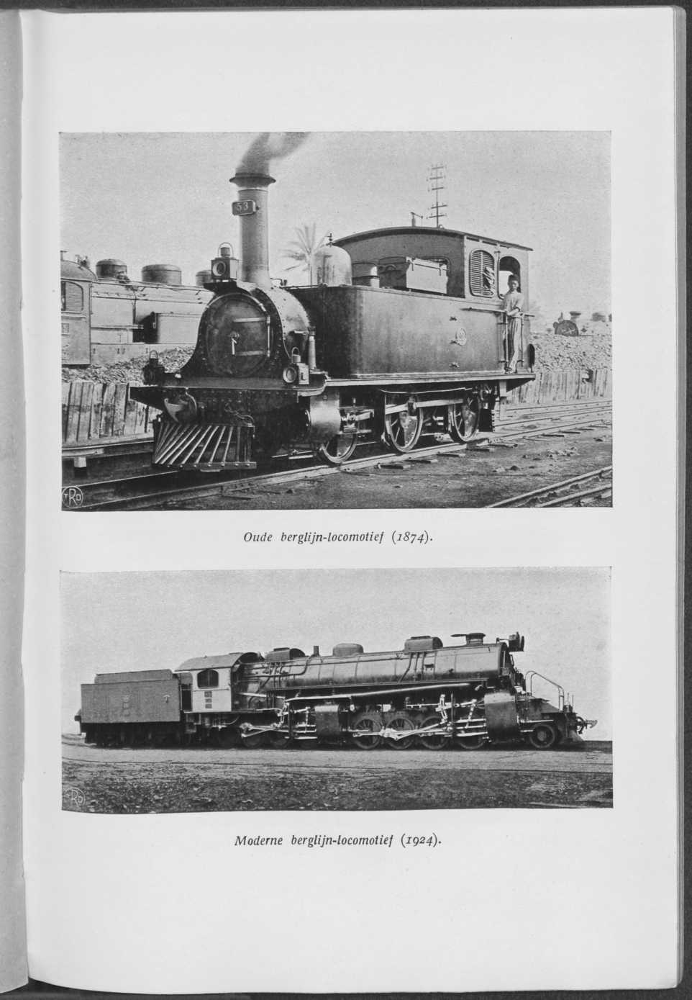
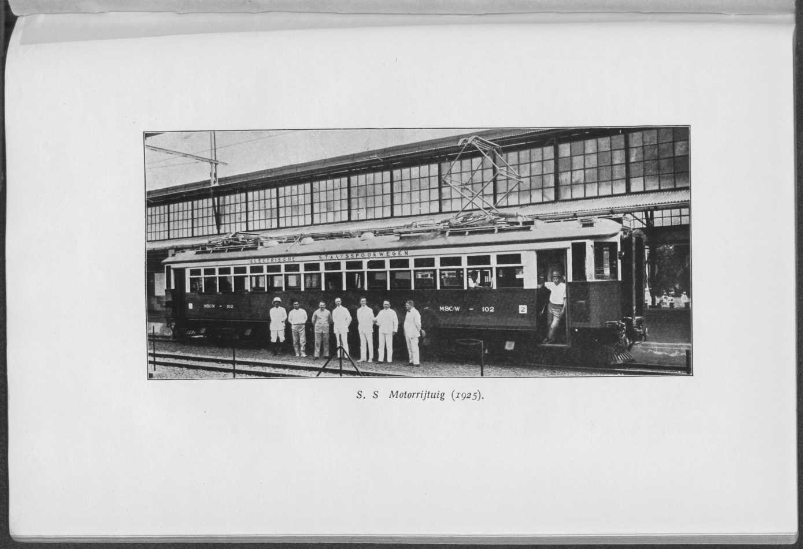

# Bab VII. Kurun 1906 hingga Sekarang

Bila, seperti pada bab-bab sebelumnya, uraian dimulai dengan sejarah Staatsspoorwegen, maka dalam pembahasan kronologis pertama-tama patut disebut fakta bahwa, demi pengangkutan gula dari pabrik Pandji, dilakukan perpanjangan lintas samping kecil Soemberkolak-Sitoebondo sampai Pandji (3 K.M.), setelah itu eksploitasi seluruh lintas kecil itu berlangsung sebagai trem sepur normal. Pembentuk undang-undang tidak diajak berunding dalam hal ini, sebab Gubernur Jenderal (Landvoogd), dengan surat Sekretaris Pemerintah Pertama (1en Gouvernements Secretaris) tanggal 20 September 1907 No 2574, telah memerintahkan pembangunannya, yang sudah selesai pada 1 Mei 1908.

Lebih penting ialah pembangunan mata rantai yang hilang dalam hubungan sepanjang Pantai Utara. Yang dimaksud ialah lintas dari Tjikampek ke Cheribon. Setelah berdasarkan undang-undang tanggal 14 Juni 1909 (Ind. Stbl. No 477) diputuskan untuk membangunnya, lintas yang panjangnya 137 K.M. itu mulai dieksploitasi pada 3 Juni 1912. Jauh sebelum lintas itu rampung, dana untuk sebuah lintas cabang Djatibarang-Indramajoe sepanjang 19 K.M. telah disetujui; trem sepur normal ini rampung pada 15 September 1912.

Salah satu akibat dari gagasan untuk mengalirkan lalu lintas sehari antara Batavia dan Soerabaia melalui lintas Tjikampek-Cheribon ialah bahwa pembangunan lintas dari Cheribon ke Kroja dengan sendirinya mendesak untuk dibangun. Undang-undang tanggal 31 Desember 1912 (Ind. Stbl. 1913 No 32) merupakan akibat dari upaya ini; perlawanan terhadapnya begitu rupa sehingga sebuah komisi beberapa ahli harus menerangi persoalan rentabilitasnya. Pada 1 Juli 1916 ruas lintas Cheribon-Margasari sepanjang 75 K.M. dan ruas Kroja-Patoegoeran sepanjang 51 K.M. rampung. Pada 1 Januari 1917 menyusul ruas penghubung Patoegoeran-Margasari (32 K.M.). Akan tetapi, mula-mula karena penghematan dan kemudian karena perlawanan Volksraad, hubungan sehari itu hingga kini belum terwujud, dan bermalamnya para penumpang antara Batavia dan Soerabaia di Bandoeng atau di Djokja

[hal. 70]

masih diperlukan. Sejauh itu, dengan pembangunan lintas ini tidak tercapai apa yang dibayangkan orang darinya.

Akibat dari keinginan untuk dapat menguasai keadaan perkeretaapian di Jawa Barat secara tuntas, antara lain karena kebutuhan mendesak untuk memperbaiki hubungan-hubungan di Batavia, ialah bahwa perundingan dengan Nederlandsch-Indische Spoorweg Maatschappij tentang penjualan lintas Buitenzorg-Batavia dimulai kembali. Menteri de Waal Malefijt mengajukan rancangan undang-undang untuk itu, yang menetapkan bahwa N.I.S.M. akan menerima ƒ 10.600.000 untuk lintasnya; pada pemungutan suara tanggal 18 Maret 1910 suara di Tweede Kamer (Majelis Rendah) Staten-Generaal berimbang, dan pada 11 Mei d.o.v. [singkatan dalam sumber, tidak dijabarkan] usul itu ditolak dengan 44 suara lawan 37.

Perundingan baru, yang di dalamnya N.I.S.M. menurunkan harga jual menjadi 8½ juta gulden, sebagai imbalan atas ketentuan-ketentuan konsesi yang lebih menguntungkan bagi trem-tremnya (hal itu akan dibahas di bawah pada bagian N.I.S.M.), mengakibatkan bahwa sebuah usul undang-undang baru untuk pembelian dapat diajukan. Rancangan ini diterima di Staten-Generaal, sehingga undang-undang tanggal 20 Juli 1913 (Ind. Stbl. No 469) akhirnya menjadikan lintas itu milik Negara.

Dengan selesainya pembangunan kereta api induk di Jawa, perlu disebutkan bahwa diadakan penyelidikan yang luas mengenai kemungkinan membangun lintas pengumpan (voedingslijnen). Sebelum memberikan tinjauan atas hasil penyelidikan ini, perhatian lebih dahulu ditujukan pada pembangunan lintas Bandjar-Parigi, lintas yang dimaksudkan untuk membuka Preanger Tenggara dan karena itu sepenuhnya berciri apa yang disebut lintas perintis. Dana yang berasal dari apa yang disebut "dana bantuan (hulpverschaffings-fondsen)" disetujui dengan undang-undang tanggal 18 Juli 1911 No 457. Pembangunannya menjadi riwayat penderitaan yang panjang dan kekecewaan besar. Ruas Bandjar-Kalipoetjang sepanjang 43 K.M., yang dieksploitasi sebagai trem sepur normal, baru pada 31 Juni 1921 [angka/tanggal meragukan dalam OCR: "31en Juni 1921"; tercetak demikian pula pada pindaian hal. 70, jadi bukan galat OCR, tetapi 31 Juni tidak ada dalam kalender (Juni hanya 30 hari); tidak dikoreksi] diperpanjang dengan ruas Kalipoetjang sampai Tjidjoelang sepanjang 39 K.M. Undang-undang tanggal 6 Juni 1919 Stbl. No 308 telah menunjuk Tjidjoelang sebagai titik yang lebih cocok daripada Parigi sebagai ujung lintas trem sepur normal itu.

Sebuah lintas kecil yang istimewa ialah yang dari Tjilegon ke Merak (keputusan tanggal 21 Juni 1912 No 17). Pembangunannya, yang rampung pada 1 Desember

[hal. 71]

1914, berkaitan dengan pembangunan kereta api Sumatra Selatan, yang akan dibahas dalam bagian kedua tinjauan sejarah ini, tepatnya di Bab XI. Lintas kecil ini hanya sepanjang 10 K.M.

Satu jenis lintas trem istimewa yang lahir dalam kurun ini ialah yang berlebar sepur 0.6 M.

Dengan surat Sekretaris Pemerintah Pertama tanggal 19 Mei 1908 No 1427, Pemerintah memberi wewenang kepada Inspektur Kepala S.S. untuk, sebagian dengan materiel yang menjadi tersedia, membangun sebuah lintas kecil dari Tjikampek ke Tjilamaja sepanjang 28 K.M. Pada 1 Juli 1909 pekerjaan itu rampung. Hasilnya sedemikian rupa sehingga dengan undang-undang tanggal 18 Juli 1911 (Ind. Stbl. No 459) diperintahkan pembangunan dua lintas kecil sejenis lagi, yaitu yang dari Tjikampek ke Wadas dan, di Oosthoek (Ujung Timur), dari Rambipoedji ke Poeger dengan lintas cabang. Lintas yang disebut terakhir dengan lintas cabang dari Balong ke Amboeloe itu panjangnya 40 K.M.; ia rampung pada 3 Mei 1913, setelah lintas kecil pertama sepanjang 16 K.M. mulai dieksploitasi pada 15 Juni 1912. Dengan undang-undang tanggal 4 Januari 1916 Ind. Stbl. No 36, selanjutnya disetujui dana yang diperlukan untuk pembangunan lintas Krawang-Rengasdengklok dan Krawang-Lemahabang. Lintas pertama sepanjang 21 K.M. rampung 15 Juni 1919; sebagai ganti lintas kedua dibangun sebuah hubungan Lamaran-Wadas sepanjang 15 K.M., yang dibuka untuk lalu lintas umum pada 9 Februari 1920. Harapan semula bahwa tipe sepur sempit ini akan menjadi sarana angkutan yang tepat di daerah-daerah yang lalu lintasnya belum sepenuhnya matang tidak terwujud. Kereta api dan trem swasta tidak mengikuti contoh itu, dan lintas Rambipoedji-Poeger agaknya harus dibangun ulang seluruhnya atau sebagian menjadi sepur normal, kini setelah lalu lintas meningkat dan sambungan dengan trem sepur normal Loemadjang-Kentjong-Poeger (lihat di bawah) akan diperoleh.

Dari lintas-lintas pengumpan sesungguhnya yang terwujud dalam kurun ini, kita sebut pertama-tama trem sepur normal Tasikmalaja-Singaparna (undang-undang tanggal 31 Desember 1909 Ind. Stbl. 1910 No 198); lintas ini, sepanjang 17 K.M., mulai dieksploitasi pada 1 Juni 1911.

Krian-Gempolkerep ialah sebuah lintas trem Lintas Timur, yang diperintahkan dengan undang-undang tanggal 15 Juli 1910, Ind. Stbl. No 477. Pada 1 Mei 1912

[hal. 72]

lintas sepanjang 26 K.M. itu mulai dieksploitasi. Lintas itu diperpanjang ketika pembentuk undang-undang menyetujui usul untuk meneruskannya sampai Kertosono (undang-undang tanggal 1 Juni 1918 Ind. Stbl. No 345); kemudian diputuskan bahwa ia hanya akan diteruskan sampai Plosso pada bekas Babat-Djombang Stoomtram. Trem ini, sebagai akibat undang-undang tanggal 29 Juli 1916, Ind. Stbl. No 646, telah diambil alih oleh Negara seharga ƒ 2.000.000, karena orang melihat padanya ancaman terus-menerus berupa pengurasan angkutan dari Lintas Timur.

Ruas sepanjang 20 K.M. sampai Plosso dibuka untuk lalu lintas pada 1 September 1921. Agar memperoleh sambungan langsung ke stasiun S.S. di Djombang, bagian trem Kediri di sebelah utara jalan kereta api dibeli dari K.S.M. pada September 1918 seharga ƒ 100.000; penyerahannya berlangsung pada 1 November 1918.

Undang-undang tanggal 4 Januari 1916 Ind. Stbl. No 36 menjadi dasar pembangunan lintas Rogodjampi-Kalisetail, yang semula dimaksudkan sebagai sepur sempit, tetapi akhirnya dibangun dengan sepur normal dari Rogodjampi sampai Bentjoeloek, dan lintas Rantjaekek ke Djatinangor, langkah pertama ke arah Lintas Preanger menuju Cheribon. Dari lintas yang disebut pertama di Oosthoek, ruas Rogodjampi-Srono sepanjang 13 K.M. mulai dieksploitasi sebagai trem pada 26 Oktober 1921, pada 1 November 1922 menyusul ruas Srono-Bentjoeloek sepanjang 5 K.M.; dari lintas yang lain, yang ke Djatinangor, ruas sampai Tandjongsari sepanjang 12 K.M. rampung pada 13 Februari 1921, setelah dengan undang-undang tanggal 23 Februari 1918 Ind. Stbl. No 181 ditetapkan bahwa lintas dari Djatinangor melalui Tandjongsari akan diteruskan sampai Tjitali. Akibat keadaan zaman, untuk sementara dibatalkan pembangunan ruas Tandjoengsari ke Tjitali.

Dari lintas trem Bandoeng-Koppo (undang-undang tanggal 1 Juni 1918, Ind. Stbl. No 345), lintas Bandoeng-Soreang bersama lintas penghubung Kiaratjondong-Kareës, seluruhnya sepanjang 29 K.M., mulai dieksploitasi pada 13 Februari 1921. Lintas samping Dajeuhkolot-Madjalaja sepanjang 18 K.M. dibuka untuk lalu lintas umum pada 3 Maret 1922; pembangunan lintas terakhir ini telah diperintahkan dengan undang-undang tanggal 28 Februari 1920, Ind. Stbl. No 150.

Pada 1919 dengan undang-undang tanggal 6 Juni, Ind. Stbl. No 312, pembangunan lintas dari Toeloeng Agoeng ke Toegoe disetujui. Ruas pertama,

[hal. 73]

sepanjang 14 K.M. sampai Tjampoerdarat, rampung pada 15 Juli 1921, ruas perpanjangan sepanjang 25 K.M. sampai Trenggalek pada 1 Juli 1922, ruas sepanjang 9 K.M. sampai ujung lintas di Toegoe pada 3 Januari 1923.

Dua perpanjangan lintas trem Ponorogo, yaitu dari Soemoroto sampai Badegan dan dari Balong ke Slahoeng, disetujui dengan undang-undang tanggal 22 Desember 1919 Ind. Stbl. 1919 No 53; lintas-lintas sepanjang 10 dan 9 K.M. itu mulai dieksploitasi pada 1 Agustus 1922.

Dengan undang-undang tanggal 28 Februari 1920 Ind. Stbl. No 150, selain lintas samping Tjiteureup (Dajeuhkolot)-Madjalaja yang dibahas di atas, trem-trem Djatibarang-Karangampel dan Djatibarang-Eretan pun dipertimbangkan untuk dibangun. Ruas sampai Karangampel sepanjang 18 K.M. dibuka untuk lalu lintas pada 1 Mei 1926; pembangunan lintas yang terakhir belum dimulai.

Dari empat trem yang pembangunannya diperintahkan dengan undang-undang tanggal 18 Maret 1921, Ind. Stbl. No 204, lintas Tjitali-Soemedang dan lintas Bandjaran-Pengalengan untuk sementara tidak dibangun karena pertimbangan penghematan. Lintas Koppo-Tjiwedej, perpanjangan lintas trem Preanger dekat Bandoeng, sepanjang 12 K.M., rampung pada 17 Juni 1924. Perpanjangan lintas cabang ke Garoet, yaitu sampai Tjikadjang, pada awal 1928 masih dalam pelaksanaan.

Sebagai akibat pekerjaan untuk memperbaiki keadaan perkeretaapian di sekitar Batavia, ruas Tanah Abang-Manggarai (6 K.M.) mulai dieksploitasi pada 1 Agustus 1922 dan ruas Angkee-Kampoeng Bandan (4 K.M.) pada 12 September 1923.

Terakhir perlu disebutkan bahwa pada 1926 pembentuk undang-undang menyetujui usul-usul untuk membangun sebuah trem dari Loemadjang, sebuah stasiun pada lintas trem S.S. Klakah-Pasirian, ke Kentjong dan lintas Poeger, agar dapat melayani angkutan beberapa pabrik gula yang baru didirikan di Zuid-Tanggoelsche (undang-undang tanggal 28 Juni 1926 Ind. Stbl. No 305). Pada awal 1928, sejauh diketahui di Belanda, lintas sepanjang 42 K.M. ini belum dieksploitasi; hanya diketahui bahwa pada September 1927 stasiun Balong dipilih sebagai titik sambungan dengan lintas Poeger. Pembangunan trem ini membuat orang mempertimbangkan gagasan untuk juga membangun ulang lintas sambungan Rambipoedji-Poeger dari trem sepur sempit menjadi trem sepur normal.

[hal. 74]

Satu perubahan penting lagi ialah bahwa pada hari peringatan ke-50 pengumuman undang-undang pembangunan lintas negara pertama, pada lintas dari Tandjong Priok ke Meester Cornelis diberlakukan traksi listrik. Secara bertahap hal itu dilakukan juga pada lintas-lintas kota lainnya. Saat ini orang sedang mengelektrifikasi lintas Batavia-Buitenzorg.

Sebelum beralih ke sejarah kereta api swasta dalam kurun sesudah 1906, perlu lebih dahulu ditunjukkan bahwa pada 1909 dinas Kereta Api dan Trem Negara (Staatsspoor- en Tramwegen) beralih ke Departemen Perusahaan Pemerintah (Departement van Gouvernementsbedrijven) yang didirikan pada 1 Januari 1908, tanpa hal itu menimbulkan perubahan pada jalannya perusahaan. Namun pada pertengahan 1917 pimpinan S.S. dibebaskan dari Pengawasan atas Dinas Kereta Api dan Trem (Toezicht op de Spoor- en Tramwegdiensten) (terhadap penggabungan apa yang disebut "pengawasan" dengan pimpinan S.S. itu bertahun-tahun diprotes di dalam dan di luar lembaga perwakilan rakyat), dan dari biro "Tenaga Air" (Waterkrachten), yang sebagai "Dinas Tenaga Air dan Listrik" (Dienst voor Waterkracht en Electriciteit) yang berdiri sendiri beralih ke Departemen Perusahaan Pemerintah (juga pada pertengahan 1917); tetapi urusan-urusan yang kian bertambah dari jaringan yang terus meluas, penambahan kereta api di Pantai Barat Sumatra dan Atjehtram, yang hingga kini langsung berada di bawah Departemen Perusahaan Pemerintah (dahulu B.O.W.) dan Departemen Perang, serta dinas otomobil negara (landsautomobieldiensten) di Sumatra dan Jawa, membuat reorganisasi diinginkan pada 1917, yang di dalamnya antara lain wilayah-wilayah eksploitasi (exploitatiekringen) jaringan Jawa dihapuskan. Hal ini masih terjadi di bawah pengelolaan Inspektur Kepala M.H. Damme, yang pada waktu mengundurkan diri pada 1918 digantikan oleh sebuah pimpinan tiga orang yang terdiri atas Tuan-tuan F.E. van Hennekeler, W.F. Staargaard, dan F.B.H. Asselbergs. Sesudah 1921 orang kembali ke pimpinan satu orang (inspektur kepala J.C.F. van Sandick), sedangkan setelah ia wafat inspektur kepala W.F. Staargaard memasukkan kembali dua wilayah eksploitasi Lintas Timur dan Lintas Barat ke dalam perusahaan Jawa.

Agar uraian tidak menjadi tidak lengkap, tidak boleh dilewatkan untuk menarik perhatian pada dua perjanjian dengan N.I.S.M. yang sangat besar pengaruhnya atas lalu lintas kereta api, yaitu terwujudnya sebuah perjanjian (19 Juni-1 Juli 1925) yang di dalamnya

*Oude berglijn-locomotief (1874). (Lokomotif lintas gunung lama (1874)). Moderne berglijn-locomotief (1924). (Lokomotif lintas gunung modern (1924)). Gambar sisipan antara hal. 74 dan 75.*

[hal. 75]

N.I.S.M. mengikatkan diri untuk membangun sebuah hubungan terpisah (vrijliggende verbinding) untuk sepur normal antara Solo dan Djokja dan menyewakannya kepada Pemerintah, dan sebuah perjanjian yang diperbaiki tentang pembagian angkutan yang berlaku mulai 1 April 1926, yang dimaksudkan untuk mengakhiri persaingan angkutan antara S.S. dan N.I.S.M. yang kian tajam. Pada paruh kedua 1906 telah dibuat suatu perjanjian antara kedua pihak yang mengatur angkutan barang yang bersaing dari dan ke Soerabaia; perjanjian itu dapat dipandang sebagai pendahulu perjanjian 1926.

Perundang-undangan kereta api dan trem yang sama sekali baru, setelah persiapan bertahun-tahun, muncul dalam lembaran negara (staatsblad) pada awal 1927. Perundang-undangan yang ada membagi jalan besi menjadi kereta api (spoorwegen) yang dapat dilalui dengan kecepatan 60 K.M. per jam dan lebih, kereta api sekunder (secundaire spoorwegen), trem (tramwegen) yang dimaksudkan untuk dilalui dengan kecepatan 30 K.M. (dalam hal khusus 45 K.M.), dan akhirnya trem kota (stadstramwegen), yang dimaksudkan untuk melayani lalu lintas di satu atau beberapa kota praja yang berbatasan. Perundang-undangan baru berlaku atas kereta api induk, yang disebut kereta api kelas satu, atas kereta api kelas dua, yang mencakup kereta api sekunder dan trem, atas trem pedesaan (landelijke tramwegen; yakni jalur berkonstruksi ringan dan dengan peraturan operasional sederhana), dan atas trem kota, sejauh pemerintah pusat berkepentingan dengannya.

Di atas telah disebutkan upaya Negara yang gagal untuk membeli lintas Buitenzorg-Batavia pada 1910 seharga ƒ 10.600.000. Segera setelah usul undang-undang ditolak di Tweede Kamer, perundingan dimulai kembali untuk memperoleh harga beli yang ditetapkan sebesar ƒ 8.500.000. Sebagai kompensasi atas jumlah yang lebih rendah yang akan diterima N.I.S.M. dalam bentuk uang, syarat-syarat konsesi trem-trem yang dieksploitasi perseroan itu akan ditinjau kembali, dan tanggal kemungkinan pengambilalihan paksa (naasting) akan ditunda sampai 31 Desember 1935. Pada saat itu beberapa permohonan N.I.S.M. berada pada Pemerintah, yaitu 1e. untuk perubahan syarat-syarat konsesi lintas trem Solo-Bojolali yang dibeli pada 1905 dari Solosche Tramweg Maatschappij, 2e. untuk memperoleh kon-

[hal. 76]

sesi bagi lintas-lintas Bodjonegoro-Lasem, Srandakan-Sewoe Galoer, Bantool-Karang Asem dan dari Solo ke Wonogiri, dan 3e. konsesi untuk sebuah lintas trem sepur normal dari Semarang melalui Broemboeng ke Gambringan. Selama perundingan, permohonan-permohonan ini mengalami beberapa perubahan, sehingga permohonan itu akhirnya berbunyi: menyetujui syarat-syarat konsesi baru untuk lintas-lintas yang telah dibangun dan, dengan syarat-syarat yang sama, memberikan konsesi untuk:

A. perpanjangan lintas Djokja-Brosot sampai Sewoegaloer;
B. sebuah lintas cabang dari lintas Djokja-Brosot melalui Passar Gedeh ke lintas kereta api Djokja-Solo;
C. lintas-lintas cabang berikut dari lintas Goendih-Soerabaia di Rembang:
   1e. dari Bodjonegoro melalui Pontjo ke Djatirogo;
   2e. dari Babat melalui Ngidon ke Djenoe;
   3e. dari Pontjo melalui Rengel ke Ngidon;
   4e. dari Soerabaia ke Grissee;
D. perpanjangan trem uap Solo-Bojolali, yang berjalan dari Solo melalui Wonogiri ke Kakap;
E. sebuah lintas yang berjalan dari stasiun Tawang di Semarang melalui Broemboeng ke Gambringan pada lintas Goendih-Soerabaia.

Dengan keputusan tanggal 28 Oktober 1913 No 13, syarat-syarat konsesi yang ada diubah dan yang baru disetujui.

Dalam perjalanan tahun-tahun, pada sebagian hubungan ini terjadi perubahan; demikianlah pada 1923 diberikan pembebasan dari kewajiban membangun lintas cabang Passar Gedeh-Magoewo, sedangkan ditetapkan bahwa sebagai ganti Djenoe yang disebut pada C butir 2, tempat Merak-Oerak akan menjadi ujung lintas. Konsesi Soerabaia-Grissee juga diubah menjadi Kandangan-Grissee, dan diberikan pembebasan dari pembangunan lintas dari Batoeretno ke Kakap pada lintas Wonogiri. Konsesi Pontjo-Ngidon dikembalikan pada 1926; sebaliknya lintas-lintas lainnya terwujud antara 1919 dan 1924.

Mengenai perjanjian pembangunan hubungan terpisah antara Solo dan Djokja dan perjanjian tentang pembagian angkutan antara N.I.S.M. dan S.S., telah dibicarakan di atas.

Samarang-Joana Stoomtram Maatschappij pada awal 1910 meminta konsesi untuk sebuah lintas Djatirogo-Bodjonegoro. Sehubungan dengan rencana-rencana yang oleh residen Rembang, Tuan J.L. Gonggrijp,

[hal. 77]

dipropagandakan untuk pendirian pabrik gula, pembangunan trem, dan sebuah tempat pemuatan ke kapal, N.I.S.M. pun segera sesudahnya meminta konsesi untuk pembangunan trem di daerah Rembang. Perundingan timbal balik yang dipimpin Direktur Perusahaan Pemerintah, Tuan H.J.E. Wenckebach, disusul pembicaraan di Batavia, mengakibatkan bahwa S.J.S. pada 1911 meminta konsesi untuk lintas Lasem-Ngandang-Djatirogo, yang diberikan dengan keputusan tanggal 17 Juli 1912 No 40.

N.I.S.M. kemudian mengubah trase-trase yang diberikan kepadanya menjadi trase-trase yang pada 1913 (lihat di atas pada C.) diperoleh dengan keputusan tanggal 28 Oktober 1913 No 13.

Dari lintas Djatirogo-Lasem milik S.J.S., ruas Lasem-Pamotan (10 K.M.) mulai dieksploitasi pada 1 Juni 1914, ruas Pamotan-Djatirogo sepanjang 24 K.M. pada 20 Februari 1919. Perang besar telah berpengaruh sangat menghambat.

Di sini tempatnya menyebutkan hasil perundingan antara kota praja Semarang dan S.J.S. mengenai lintas-lintas kota milik perseroan itu. Bertahun-tahun perundingan ini berlarut-larut, hingga pada 1921 tercapai kesepakatan. Pada 1 Januari lintas-lintas kota beralih menjadi milik kota praja; S.J.S. untuk sementara tetap mengeksploitasi jaringan itu, sambil membayar uang sewa kepada kota praja.

Perlu disebut pula bahwa "Komisi Penyelidikan Keadaan Kereta Api dan Trem di dalam dan di sekitar Semarang" ("Commissie tot Onderzoek der Spoor- en Tramwegtoestanden in en om Semarang") menyelesaikan laporannya pada 1924 dan menerbitkannya dalam cetakan pada 1925.

Semarang-Cheribon Stoomtram Maatschappij pada 23 Maret 1909 menyampaikan sebuah nota kepada Pemerintah Hindia, yang menunjukkan bahwa ia hendak membuat lintas induk dapat dilalui dengan kecepatan lebih tinggi, sedemikian rupa sehingga jarak Batavia-Semarang dapat ditempuh dalam satu hari. Hal ini akan dilakukan antara lain dengan membangun ulang badan jalan dan membuat dua pemendekan lintas (afkortingen). Sebagai akibat keputusan agar hubungan Cheribon-Kroja dibangun oleh Negara dan karena beberapa kesalahpahaman yang timbul, baru pada 1911 S.C.S. mengajukan permintaan untuk pemendekan Kaliwoengoe-Pegandon. Setelah diberikan dengan keputusan tanggal 12 Juli 1911 No 5, lintas Kaliwoengoe-Kalibodri sepanjang 12 K.M. rampung pada 1 Januari 1914. Pemendekan Bedilan-Kantji (28 K.M.) diberikan dengan keputusan tanggal 1 Mei 1912 No 1; pada 1914 lintas itu disebut Losari-Moendoe.

[hal. 78]

Lintas itu rampung pada 1 Mei 1915. Akibat perbaikan-perbaikan jalan ini ialah bahwa pada 1 Januari 1914 selesainya hubungan sehari antara Batavia dan Semarang dapat dirayakan dengan meriah.

Upaya S.C.S. pada awal 1913 untuk mengubah konsesi tremnya menjadi konsesi kereta api tidak berhasil. Perundingan yang berlarut-larut menyebabkan baru pada Oktober 1918 S.C.S. diberi tahu bahwa terdapat keberatan prinsip terhadap pengubahan konsesi trem menjadi konsesi untuk kereta api. Sekaligus ditanyakan apakah S.C.S. bersedia ikut bekerja sama untuk membuat suatu pengaturan yang pada dasarnya berupa sewa-beli (huurkoop) lintas-lintasnya oleh S.S. S.C.S. pada prinsipnya tidak menunjukkan keengganan terhadap hal itu. Orang belum sampai pada penyelesaian atas banyak kesulitan itu.

Perlu disebutkan pula bahwa S.C.S. memperoleh sambungan lintas Tegal-Balapoelang dengan lintas Cheribon-Kroja milik S.S. melalui pemberian konsesi Balapoelang-Margasari (Proepoek) dengan keputusan tanggal 12 Juli 1911 No 5. Pada 1 Mei 1918 lintas sepanjang 15 K.M. itu rampung.

Pembangunan konsesi yang diberikan dengan keputusan tanggal 30 Agustus 1913 No 42 untuk lintas samping Pekalongan-Kedoengwoeni-Wonopringgo (12 K.M.) rampung pada 7 Februari dan 1 Desember 1916.

Terakhir perlu disebutkan bahwa lintas samping dari lintas Cheribon-Kadipaten, yakni hubungan Djamblang-Goenoeng Giwoer, dikonsesikan dengan keputusan tanggal 28 April 1920 No 46; pada 1 Juli 1922 lintas Klangenan-Goenoeng Giwoer sepanjang 5 K.M. mulai dieksploitasi.

Serajoedal Stoomtram Maatschappij memperluas kegiatannya dengan menerima dan melaksanakan konsesi yang diberikan kepadanya dengan keputusan tanggal 22 Juli 1912 No 12 dan menyangkut perpanjangan sepanjang 23 K.M. dari Bandjarnegara sampai Wonosobo. Ruas pertama sampai Selokromo mulai dieksploitasi pada 1 Mei 1916, ruas kedua (14 K.M.) pada 7 Juni 1917.

Oost-Java Stoomtram Maatschappij hanya mengalami perluasan kecil dengan rampungnya, pada 1 April 1909, lintas kecil Modjokerto-Wates sepanjang 8 K.M., yang untuknya ia telah memperoleh izin resmi dengan keputusan tanggal 25 Mei 1909 No 37.

Jaringan kota O.J.S. mengalami perubahan penting. Pertama, dengan keputusan tanggal 25 November 1916 No 56, O.J.S. memperoleh konsesi untuk lintas trem uap sepanjang 16 K.M. dari Regent-

*S. S Motorrijtuig (1925). (Kendaraan bermotor S.S. (1925)). Gambar sisipan antara hal. 78 dan 79.*

[hal. 79]

straat ke Tandjong Perak, pelabuhan Soerabaia, yang rampung pada 1 Agustus 1920. Menurut keputusan yang sama, traksi listrik boleh diterapkan; hal itu terjadi pada pembukaan apa yang disebut lintas III.

Selain itu, keputusan yang sama memberikan konsesi untuk sejumlah lintas trem listrik, yang mulai dieksploitasi pada 15 Mei, 12 Juli 1923, dan 11 Februari 1924. Trem uap antara Wonokromo dan Stadstuin dihapuskan pada 15 Mei 1923.

Kediri Stoomtram Maatschappij, setelah rampungnya lintas Brengolo-Plosso-Klaten, tidak memperluas jaringannya.

Malang Stoomtram Maatschappij meminta dan memperoleh, dengan keputusan tanggal 13 Agustus 1908 No 2, konsesi untuk sebuah lintas cabang ke Toeren (1 K.M.), yang selesai pada 25 September 1908.

Pasoeroean Stoomtram Maatschappij memperoleh, dengan keputusan tanggal 19 Desember 1910 No 2, konsesi untuk sebuah lintas samping di tepi kiri Sungai Gembong dan, dengan keputusan tanggal 17 Juni 1911 No 19, untuk sebuah lintas samping dari Waroengdowo ke Ngempit. Lintas-lintas ini, masing-masing sepanjang 3 dan 5 K.M., mulai dieksploitasi pada 27 Maret dan 1 Desember 1912.

Probolinggo Stoomtram Maatschappij membangun lintas Oemboel-Soemberkarang dan Probolinggo-Oemboel. Lintas-lintas sepanjang 3 K.M. ini dibuka untuk lalu lintas barang pada 6 Agustus 1912; konsesi telah diberikan dengan keputusan tanggal 25 Maret 1909 No 4, dan 11 April 1912 No 5.

Madoera Stoomtram Maatschappij menerima, dengan keputusan tanggal 17 Januari 1921 No 11, konsesi untuk lintas Kamal-Kwanjar sepanjang 16 K.M., yang dapat dibuka pada 1 September 1913. [angka/tanggal meragukan dalam OCR: "17en Januari 1921 No 11" dan "1 September 1913"; keduanya terbaca sama pada pindaian hal. 79, sehingga selisihnya (konsesi 1921, pembukaan 1913) berasal dari buku asli; bagian Madoera Stoomtram di Bab VI melaporkan lintas Kamal-Bangkalan sudah beroperasi sejak 1898; tidak dikoreksi]

Mengenai trem-trem kota di Batavia, perlu disebutkan bahwa Nederlandsch-Indische Tramweg Maatschappij, dengan keputusan tanggal 28 April 1911 No 1 dan 12 Mei 1914 No 7, memperoleh konsesi untuk penggandaan jalur Kramat-Meester Cornelis. Ruas pertama sampai apa yang disebut Driesprong rampung pada 17 Juni 1913, ruas kedua sampai Kampoeng Malajoe rampung dalam tahun 1915.

Batavia Electrische Tram Maatschappij memperluas konsesinya pada 1909 (keputusan tanggal 28 Juli 1909 No 1). Dengan itu ia memperoleh izin membangun sebuah lintas dari Koningsplein Noord-Willemslaan-Cipayersweg dan sebuah lagi dari Koningsplein Oost ke Menteng. Dengan keputusan tanggal 7 April 1912 No 13, dan tanggal 20 September 1913 No 25,

[hal. 80]

dikonsesikan sebuah arah yang diubah, sebagian dengan jalur ganda, sedemikian rupa sehingga lintas yang disebut pertama, alih-alih menyusuri sisi selatan Waterlooplein dan Cipayersweg, menyusuri sisi utara melalui Vrijmetselaarsweg ke Goenoengsari. Lintas ke Menteng (3 K.M.) mulai dieksploitasi pada 16 Oktober 1912, yang lain pada 2 Januari 1913.

Rencana elektrifikasi Nederlandsch-Indische Tramweg Maatschappij, yang telah dimulai pada Maret 1911, tidak menghasilkan apa-apa; demikian pula upaya kota praja Batavia untuk membeli lintas itu. Kota praja juga tidak memperoleh lintas-lintas Batavia Electrische Tram Maatschappij. Belakangan ini tampaknya orang mengarah pada pendirian apa yang disebut perusahaan campuran (gemengd bedrijf), yang di dalamnya kota praja dan kedua perseroan trem akan ikut serta.

Perlu disebut pula bahwa dengan keputusan tanggal 3 Mei 1917 No 19, sebuah izin diberikan kepada Landbouw Maatschappij "Madjenang" untuk membangun dan memakai sebuah lintas trem antara Madjenang dan halte S.S. Meloewoeng pada Lintas Barat. Izin ini dicabut dengan keputusan tanggal 1 Februari 1925 No 64, karena dinas dihentikan dan jalur dibongkar.
